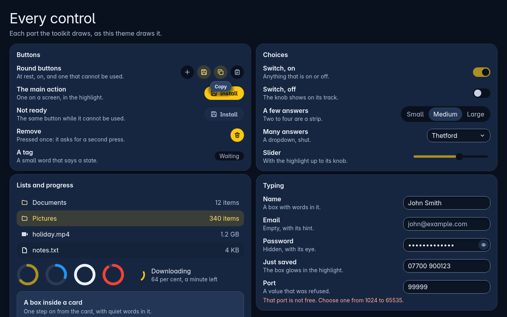
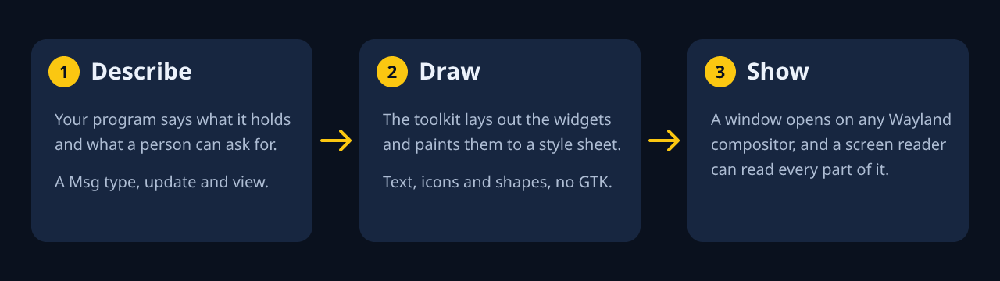
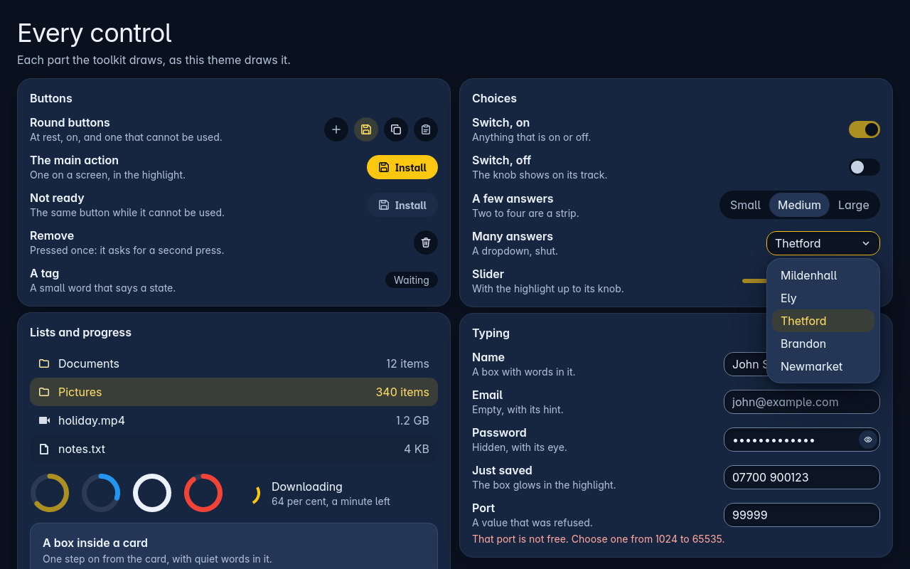

<p align="center">
  
</p>

<p align="center">
  
  
  
  
</p>

Comments are stripped from the published code to keep it lean.

The Trindle Toolkit is a Rust library for windows on Wayland: widgets, drawing, text, icons, a style sheet, the screen reader link and the input method. Nothing under it is GTK, Qt or any other C toolkit. It is the toolkit Trindle's own programs are drawn with, and any other program can use it.

Choose it if you want a small, plain Rust crate that opens a window on any Wayland compositor with the ordinary window protocol (`xdg_wm_base`), such as Mutter, KWin, Sway or Trindle's own. The look comes from one style sheet, not from code, and every window can be read by a screen reader. There is no X11 back end.

<p align="center">
  
</p>

## How it works

<p align="center">
  
</p>

A program is a type that implements `ui::App`: a `Msg` type for what the person can ask for, `update` to change the program's state, and `view` to return the widgets for that state. `ui::Shown::run` opens the window and runs the program until it is closed; `ui::Shown::open` puts a window on screen inside a `Loop` you run yourself.

## Quick start

Add the crate to your `Cargo.toml`. It needs Rust 1.85 or newer.

```toml
[dependencies]
trindle-toolkit = { git = "https://github.com/trindle-os/trindle-toolkit" }
```

A window with a button that counts its presses (this is `examples/hello.rs`):

```rust
use trindle_toolkit::t;
use trindle_toolkit::ui::{App, Shown};
use trindle_toolkit::widget::{column, label, main_word, Node};
use trindle_toolkit::window::Kind;

/// What the window holds: how many times the button was pressed.
struct Hello {
    pressed: u32,
}

/// What the person can ask for.
#[derive(Clone)]
enum Msg {
    Press,
}

impl App for Hello {
    type Msg = Msg;

    fn update(&mut self, msg: Msg) {
        match msg {
            Msg::Press => self.pressed += 1,
        }
    }

    fn view(&self) -> Node<Msg> {
        let said = match self.pressed {
            0 => t!("kit-example-hello-none").to_string(),
            n => t!("kit-example-hello-pressed", n = n),
        };
        column(vec![label(said), main_word(t!("kit-example-hello-button")).on_press(Msg::Press)]).padding(24.0).gap(16.0).centred()
    }
}

fn main() {
    let kind = Kind::Window { title: t!("kit-example-hello-title").into(), app_id: "org.example.Hello".into() };
    if let Err(why) = Shown::run(kind, (320, 160), Hello { pressed: 0 }) {
        eprintln!("{why}");
        std::process::exit(1);
    }
}
```

The words come from language files, so the program also needs entries for the keys it asks for. The ones for this example are in `share/lang/en/toolkit-examples.ftl`. The guide, [docs/guide.md](docs/guide.md), goes on from here, and [docs/reference.md](docs/reference.md) has every widget and every part a program can paint for itself.

Nine examples in `examples/` each open one window. They are built to check they compile; run one only on a Wayland desktop, and read it first.

| Example | What it shows |
|---|---|
| `hello` | A button that counts its presses |
| `notes` | A text box of five lines that saves as you type; the saved words are shown back |
| `names` | A list of twenty made-up names that is only read |
| `gallery` | Buttons, a switch, a strip of answers, a dropdown, a slider, a text box and a ring in one scrolling page, each changing something you can see (`src/gallery.rs` is the test that draws every control for the pictures in this page) |
| `widgets` | Every common widget beside the code that makes it, taken from the same lines (`showcase::page`) |
| `context_menu` | A card whose context menu pins or removes it, by pointer, finger, keyboard or screen reader |
| `menu_bar` | A menu bar with File and View menus: shortcut hints, a rule between groups, a tick, radio rows in a sub-menu, Alt with a letter, arrow keys and type-ahead |
| `cells` | A grid you paint yourself, as a terminal does: monospace font, wide characters, keys, copy, scroll-back, window title |
| `bench` | A repeatable drawing benchmark: a 10,000-row list scrolled at a set speed, a spinner, a progress bar, a clock and a changing text box, for N seconds (default 20). Run with `TRINDLE_DRAWN_BY_GPU=1` for the GPU or without it for the processor, `TRINDLE_DRAWN_BY_SERVICE=1` with `trindle-draw` running for the drawing service, or `-- 20 --both` to run the first two in turn and print them side by side, or `-- 20 --programs` for 1, 3 and 6 programs of each way of drawing, adding up the service. It prints the drawer really used and why if the processor drew, frame times, CPU time and memory |

```sh
cargo +1.85 build --release --examples --features ui,testing
cargo +1.85 run --release --example notes
```

## Features

A dropdown opens as a list that floats over the page and moves nothing.

<p align="center">
  
</p>

- Layout: columns, rows, grids, bento tiles, cards, scrolling, layers.
- Controls: buttons, switches, sliders, a strip of answers, dropdowns, lists, text boxes with a hidden-password mode, rings and a spinner, a colour picker, date and time entry, settings rows and pages.
- Parts you paint: a table, a tab bar, a text area with undo and wrapping, a grid of tiles, zoom and crop for a picture, and a cell grid for a terminal.
- A screen reader link: every window publishes an AccessKit tree while a reader is listening.
- Reading help: `polite()` and `assertive()` make a changed notice or count a live region the reader speaks; `landmark(Landmark::Main)` and its kin mark the big parts of a window to jump between; a test names every widget the gallery builds and fails on any part the keyboard reaches that a reader cannot name.
- High contrast (seven to one for words, four and a half for edges), large text and reduced motion, from a person's own style sheet or the desktop's settings.
- The input method, the clipboard, drag and drop, and keyboard shortcuts.
- Desktop notifications and a tray icon over D-Bus; the desktop's light or dark look and accent colour followed through the settings portal.
- Words in language files, with plurals; folders for 17 languages are included.
- Windows, panels and a session lock (the lock is not yet stable and has only been run against a stand-in compositor).

## Widgets

Each is a function in `widget` or the module named, and returns a `Node<Msg>`. Settings such as `.padding(24.0)` and `.on_press(msg)` are methods on the node. [docs/reference.md](docs/reference.md) says more about each, and `cargo run --example widgets` shows them with their code. Every row except three in Desktop and system has a short guide with a picture, linked in its last column, and [docs/widgets](docs/widgets/README.md) lists them all.

**Layout**

| Widget | What it is | Guide |
|---|---|---|
| `column`, `row` | Items one above another, or side by side | [Guide](docs/widgets/row-and-column.md) |
| `grid`, `even_grid`, `bento` | Tiles packed into bands that fill the width | [Guide](docs/widgets/grids.md) |
| `flow` | Items that wrap onto the next line, as words do | [Guide](docs/widgets/flow.md) |
| `card`, `frames::frame` | A raised panel; a card under a name | [Guide](docs/widgets/card-and-frame.md) |
| `layers`, `placed`, `frames::fixed` | Items over one another, at a place you give | [Guide](docs/widgets/layers.md) |
| `aspect` | An item kept to a shape (width over height) | [Guide](docs/widgets/aspect.md) |
| `space`, `section_rule` | Empty room that takes what is left; a thin line | [Guide](docs/widgets/space-and-rule.md) |
| `scroll`, `scroll_x`, `slide` | Scrolling up and down, sideways, or a sideways window you move | [Guide](docs/widgets/scrolling.md) |
| `split`, `split_down` | Two areas with a divider you drag | [Guide](docs/widgets/split.md) |
| `frames::badged`, `frames::revealer` | A badge over a corner; an item faded in and out | [Guide](docs/widgets/badged-and-revealer.md) |
| `side_panel`, `dock::Dock` | A panel that slides in; panels round a main area | [Guide](docs/widgets/side-panel-and-dock.md) |

**Text**

| Widget | What it is | Guide |
|---|---|---|
| `label`, `note`, `figure` | Plain words, small quiet words, a big figure | [Guide](docs/widgets/label-note-figure.md) |
| `title`, `page_title`, `lead`, `heading`, `headline`, `section`, `side_heading`, `form_label`, `column_heading` | One function for each role words can have | [Guide](docs/widgets/text-roles.md) |
| `rich`, `editing::rich_box::RichBox` | A paragraph of bold, italic, code and link words; a box to type them | [Guide](docs/widgets/rich-text.md) |
| `code::view`, `help::view` | Read-only code with line numbers; a help page from markdown or HTML | [Guide](docs/widgets/code-and-help-views.md) |
| `link`, `link_named` | A button that leads to a web address, never underlined | [Guide](docs/widgets/link.md) |

**Buttons and choices**

| Widget | What it is | Guide |
|---|---|---|
| `button`, `main_word`, `main_action`, `quiet_action`, `word_button` | An icon button (a plain icon, a soft square when pointed at or on); the one main action; a quiet worded button with an icon; a small word button | [Guide](docs/widgets/buttons.md) |
| `remove`, `remove_by_hand` | A button that asks twice; one whose presses must be the person's own | [Guide](docs/widgets/remove-buttons.md) |
| `switch`, `tick`, `tiles::tick_box` | On and off; a tick box; the box as a picture only | [Guide](docs/widgets/switch-and-tick.md) |
| `choice`, `dropdown`, `one_of`, `tiles::radio_group` | A strip of answers; a closed list of answers; whichever suits; radio rows | [Guide](docs/widgets/choices-and-dropdowns.md) |
| `buttons::colour_button`, `font_button`, `file_button`, `lock_button` | Buttons that show a colour, a font, a file or a lock | [Guide](docs/widgets/device-buttons.md) |
| `rating::rating` | Stars you press | [Guide](docs/widgets/rating.md) |
| `icon_circle`, `icon_image` | An icon in a circle; a plain icon | [Guide](docs/widgets/icons.md) |

**Entries**

| Widget | What it is | Guide |
|---|---|---|
| `entry` | A text box of one line or, with `.lines(N)`, many; it has a password mode | [Guide](docs/widgets/entry.md) |
| `slider`, `dial::scale`, `dial::dial`, `range::Range` | A slider; one with marks; a round dial; two handles (keys, at least 24 points to touch, values told to a screen reader) | [Guide](docs/widgets/sliders.md) |
| `dial::volume` | A mute button with a slider beside it | [Guide](docs/widgets/volume.md) |
| `spin::spin`, `spin_with`, `spin::Spin`, `spin::time_spin`, `spin::month_year` | A number between Less and More buttons; a typed-in number box with limits, step, places and a unit (red words under it when the typing is out of range); a time; a year and month | [Guide](docs/widgets/spin-boxes.md) |
| `combo::combo`, `complete::Complete`, `chips::Chips` | A box with matching answers; with suggestions; with chips | [Guide](docs/widgets/combo-boxes.md) |
| `validate::CheckedBox`, `form::Form` | A box that refuses what cannot be in it; a form tied to a record | [Guide](docs/widgets/checked-box-and-form.md) |
| `picker::ColourBox`, `GradientBox`, `swatch_grid` | A colour picker; a gradient editor; a grid of swatches | [Guide](docs/widgets/colour-pickers.md) |
| `when::DateBox`, `TimeBox`, `RangeBox`, `duration::DurationBox` | A month grid, with week numbers if asked; a time; a first and last day; hours, minutes and seconds | [Guide](docs/widgets/date-and-time-boxes.md) |
| `editing::area::TextArea`, `editing::editor::Pane` | A text area with undo and wrapping; the editing engine's drawn area | [Guide](docs/widgets/text-area.md) |
| `find::Find` | A find bar with previous and next | [Guide](docs/widgets/find-bar.md) |
| `emoji_picker::emoji_page` | A page of emoji found by name | [Guide](docs/widgets/emoji-picker.md) |
| `rows::toggle_row`, `combo_row`, `entry_row`, `spin_row` | Settings rows holding a switch, a dropdown, a text box or a number box | [Guide](docs/widgets/settings-rows.md) |

**Lists and trees**

| Widget | What it is | Guide |
|---|---|---|
| `list` with `item` | Rows to choose one of, which can be dragged to reorder | [Guide](docs/widgets/list.md) |
| `tree` with `tree_row` | A tree view such as folders in a side bar | [Guide](docs/widgets/tree.md) |
| `table::Table` | A table you paint: sorts, resizes, typed in, columns moved by drag or keys, groups, rows that open under a parent (a column view), several rows chosen with a band, shows only the rows in sight | [Guide](docs/widgets/table.md) |
| `kanban::Board` | A board of cards in lanes | [Guide](docs/widgets/kanban.md) |
| `model::ListModel` | The things shown, sorted, filtered and grouped | [Guide](docs/widgets/list-model.md) |
| `outline::outline` | Places to go on a long page, with where you are marked | [Guide](docs/widgets/outline.md) |
| `open_with::chooser` | Apps to pick from, by icon and name | [Guide](docs/widgets/open-with.md) |
| `cellgrid::Screen`, `term::Term` | A grid of cells you paint, as a terminal does | [Guide](docs/widgets/cell-grid-and-terminal.md) |

**Bars and progress**

| Widget | What it is | Guide |
|---|---|---|
| `ring`, `tiles::standard_ring`, `standard_ring_with` | A ring that fills clockwise | [Guide](docs/widgets/ring.md) |
| `spinner` | A ring turning while something loads | [Guide](docs/widgets/spinner.md) |
| `bars::progress_bar`, `dial::level_bar`, `tiles::fill_bar` | A progress bar; how full something is; a fullness bar on a card | [Guide](docs/widgets/progress-bars.md) |
| `tiles::time_pie`, `tiles::bars` | A pie for time passing; a small picture of amounts | [Guide](docs/widgets/time-pie-and-bars.md) |
| `bars::Toolbar`, `bars::Tool::toggle`, `action::Actions::toolbar` | A row of icon tools with a More menu; tools that stay pressed, as Bold and Italic do; the same from named actions | [Guide](docs/widgets/toolbar.md) |
| `bars::status_bar`, `bars::path_bar` | The line at a window's foot; a place's path as pressable parts | [Guide](docs/widgets/status-and-path-bars.md) |
| `tiles::skeleton`, `tiles::loading_state` | Grey bars or a ring where data is still coming | [Guide](docs/widgets/skeleton-and-loading.md) |

**Pages and navigation**

| Widget | What it is | Guide |
|---|---|---|
| `nav::stack`, `stack_beside` | Pages named in a strip over, or in a side bar beside, the page shown | [Guide](docs/widgets/stack.md) |
| `nav::nav_view`, `nav::split_view` | A page with a back button; a side bar beside content that folds to one side when narrow | [Guide](docs/widgets/nav-view-and-split-view.md) |
| `history::History` | The steps a program has done, for Ctrl+Z and Ctrl+Shift+Z through `Ui::on_undo`; typing in one box joins into one step | [Guide](docs/widgets/history.md) |
| `nav::drawer`, `nav::bottom_sheet` | A panel laid over the edge or the foot of a page, without a pop-up | [Guide](docs/widgets/drawer-and-bottom-sheet.md) |
| `tabs::Tabs`, `toolbox::tab_pages`, `toolbox::toolbox` | A tab bar you paint; tabs over a page; a grid of tools | [Guide](docs/widgets/tabs.md) |
| `pages::preferences`, `settings::setting_page`, `settings::setting` | A preferences window; a scrolling settings page; one settings row | [Guide](docs/widgets/preferences-and-settings.md) |
| `pages::welcome_page`, `status_page`, `about_page` | A first page; a page with one thing to say; a program's about page | [Guide](docs/widgets/welcome-status-about.md) |
| `steps::wizard` | One page of a wizard with Back and Next | [Guide](docs/widgets/wizard.md) |
| `crash::page`, `settings::look_page`, `shortcuts::Shortcuts::page` | The page after a fault; the look settings; every shortcut listed | [Guide](docs/widgets/crash-look-shortcuts.md) |
| `file_page::FilePage`, `font_page::FontPage` | A file chooser and a font chooser, each a page in the window, never a pop-up | [Guide](docs/widgets/file-and-font-pages.md) |

**Menus and dialogs**

| Widget | What it is | Guide |
|---|---|---|
| `menubar::MenuBar` | A menu bar across the top of the window | [Guide](docs/widgets/menu-bar.md) |
| `popup::Popup`, `Node::menu` | A menu that floats over the page and moves nothing | [Guide](docs/widgets/popup-menu.md) |
| `Node::context_menu` | The menu any widget, and all in it, opens on a right click, a held finger, the Menu key or Shift+F10; rows can carry keys, a tick (`checked`), a dot (`radio`), a rule and a sub-menu, and a letter typed lights the next row that starts with it | [Guide](docs/widgets/context-menu.md) |
| `popup::dismissing`, `popup::under_the_i`, `hint::help_over` | An "i" panel: how it closes, where it goes, and the help over a card | [Guide](docs/widgets/i-panel.md) |
| `dialog::dialog`, `confirm`, `choose`, `ask` | A dialog as a page in place of the window's page; ready-made ones for a yes or no, one of several answers and an answer typed in (the keyboard starts on Cancel, or in the box when asking; Escape cancels) | [Guide](docs/widgets/dialog.md) |
| `palette::Palette` | A command palette | [Guide](docs/widgets/palette.md) |
| `notices::Notices::over` | A notice at the foot that never moves the page | [Guide](docs/widgets/notices.md) |
| `info::info_panel` | News in a card: note, done, warning or failed | [Guide](docs/widgets/info-panel.md) |
| `tiles::empty_state`, `empty_picture`, `error_state` | Nothing yet; nothing yet with a picture; could not be read, with a retry | [Guide](docs/widgets/empty-and-error-states.md) |
| `typing_over` | A text box that opens over a row to edit it in place | [Guide](docs/widgets/typing-over.md) |

**Charts and pictures**

| Widget | What it is | Guide |
|---|---|---|
| `charts::Chart` | Line, area, columns, spark, pie and ring charts in the sheet's colours | [Guide](docs/widgets/charts.md) |
| `image_view`, `avatar` | A picture kept in proportion; a round picture or a name's first letters | [Guide](docs/widgets/image-and-avatar.md) |
| `badges::badge_count`, `badges::avatar_group` | A count in a small box; some avatars and "+N" | [Guide](docs/widgets/badges.md) |
| `photos::gallery`, `frames::pager`, `frames::dots` | A large picture with a strip of thumbnails; pages that slide over their dots; a dot for each page | [Guide](docs/widgets/photo-gallery-and-pager.md) |
| `vector::vector` | A vector picture drawn at any size | [Guide](docs/widgets/vector.md) |
| `moving`, `player::view` | Video frames you feed; a video or sound player | [Guide](docs/widgets/video-and-player.md) |
| `tiles::sketch`, `tiles::picture`, `tiles::tile_head` | A picture drawn in units; a tile around one; the top of a card | [Guide](docs/widgets/tile-pictures.md) |
| `scene::Scene` | Items to move and zoom | [Guide](docs/widgets/scene.md) |
| `drawing` | A space you paint yourself | [Guide](docs/widgets/drawing.md) |
| `Painter` | Drawing recorded as a list and then `play`ed onto a canvas; each paint function has an `_on` version that records on one | [Guide](docs/widgets/painter.md) |

**Desktop and system**

| Widget | What it is | Guide |
|---|---|---|
| `framed` | A title bar the program draws, with minimise, maximise and close, the window menu and a shadow | [Guide](docs/widgets/framed.md) |
| `Kind::Window`, `Kind::Panel`, `Kind::Lock` | A window, a layer-shell panel or a session lock | |
| `notify`, `portal`, `mpris`, `dnd` | Notifications and a tray icon; file choosers and screenshots; media controls; drag and drop | |
| `config`, `host` | Settings kept as files in a config folder; what the program decides for itself, such as the clipboard | |

**Tools for program authors**

| Tool | What it is |
|---|---|
| Inspector (Ctrl+Shift+F12) | Names the widget under the pointer, its key, size and what a screen reader is told |
| Speed overlay (Ctrl+Shift+F11) | Frame time, memory and the share of the window painted again |
| `testing::Harness` | Drives a window with no desktop: click by name, type, read the words, take a picture |
| `showcase::page` | Every common widget beside the code that makes it |
| `trindle-new`, `trindle-sheet-check`, `trindle-lang-check` | A new program from a template; a style sheet checker; a language file checker |
| `trindle-draw` | The drawing service: the graphics chip drawing for every program of a user, so that its driver's memory is paid once (see Building it yourself) |

## Settings

There is nothing to configure in code. The only choices at build time are the Cargo features:

| Feature | On by default | What it builds |
|---|---|---|
| `ui` | yes | Everything: windows, drawing, text, widgets and the screen reader link. Includes `core`. |
| `core` | no (comes with `ui`) | The plumbing for a program with no window: files, the bus, the clipboard, language files, notifications and the windowless Wayland setup. No drawing, font, picture or screen reader code. |
| `testing` | no | What Trindle's own tests read of the toolkit: tables of what was drawn on what, stand-in mice and keyboards. Never on in a program a person runs. |
| `gpu` | no | `GpuSurface::display_ptr` and `surface_ptr`, the raw Wayland pointers EGL, Vulkan or wgpu need. Links the C library libwayland-client. Includes `ui`. |

The look is set in the style sheet; see below.

## Where your data lives

The toolkit keeps no database. It reads these, and writes nothing of its own:

| What | Where |
|---|---|
| The built-in style sheet | `share/style.css`, built into the crate |
| Your own style sheet, laid over the built-in one name by name | `~/.config/trindle/style.css` |
| Your own themes, one `.css` file each | `~/.config/trindle/themes/` |
| Language files, a folder per language | `~/.config/trindle/lang/`, then `trindle/lang` and `trindle-toolkit/lang` under each data folder |
| Fonts in your home folder | Read whole into memory by each program when its fonts are first looked for, up to 64 MB a file, because a font written over while mapped would end the program; a larger one stays mapped. A big collection under your home folder costs that memory in every program |

A name the sheet does not have is ignored, a value that cannot be read gives way to the built-in one, and every number is held within the limits written beside it in `share/style.css`, so no sheet can break a layout. A gap or size marked `(gap step)` or `(size step)` there takes only the name of a step, such as `small` or `larger`, never a number. [docs/style-sheet-for-ai.md](docs/style-sheet-for-ai.md) lists every key, what it takes and what it changes, with plain rules and a worked example for an AI (or a person) writing a theme or a sheet of their own. `share/lang/README.md` explains how to add a language.

## Security

- Passwords: a secret text box is always a password box to the screen reader, and its characters are never published.
- Files: `common::plumbing::write_private` replaces a file whole with mode 0600, never half written.
- Style sheets and themes are only ever read, never run.
- Unsafe code lives only in `src/sys/` (and `trindle-common/src/sys.rs`), behind small safe functions, and must say why it is safe: the crate denies `unsafe_op_in_unsafe_fn`, undocumented unsafe blocks and unsafe functions with no safety note.
- Sizes of pictures, masks and icon sets are capped when they are read.

To report a vulnerability, see [SECURITY.md](SECURITY.md).

## Why there is no stable list

The toolkit is young and changes fast, so it does not publish a list of calls that will never change. Older toolkits can promise that, because their big changes are rare and slow. A new one is still finding the right shapes, and a fixed list would force us to keep the early guesses. The programs built on it tell us what is missing, and we change the toolkit to fit.

The cost falls on you: pin the exact version, and read the changelog before you update.

## Building it yourself

`cargo +1.85 test --release --workspace` builds and tests on Rust 1.85, with the packages listed above installed. The repository holds two crates: `trindle-toolkit` and `trindle-common` (in `trindle-common/`), a small crate with no window, Wayland or bus code that programs without a window can use alone: home and XDG folders, a private file written whole, the settings file reader, the plugin notify line, a WAV header and the language-file list for `build.rs`. The toolkit uses it and re-exports it.

The screen reader link runs on zbus with its async-io runtime. A program that links the toolkit must not turn on zbus's `tokio` feature anywhere in the same build, because Cargo joins features across a workspace build and the link then panics with "no reactor running" and publishes no tree. Use zbus's default runtime in every crate, or build the program on its own with `cargo build -p <name>`.

On Debian 13 (and other Debian-based systems), install:

```sh
sudo apt install cargo rustc pkg-config libxkbcommon-dev libwayland-dev
```

A program built with the toolkit needs `libwayland-client0` to run, which every Wayland desktop has; `--no-default-features --features ui` leaves it out (see the `gpu` feature below). Noto Sans (regular, bold, italic and bold italic), Noto Sans Mono and Noto Sans Arabic (regular and bold) are built in, so words look and measure the same on every computer; they add 3.6 MB to a program. Text is set in Trindle Sans when it is installed, else in the built-in Noto Sans; the fixed-width font is the one fontconfig gives for "monospace" if installed, else the built-in Noto Sans Mono; letters these lack, and other scripts, come from the fonts on the computer (for example `fonts-noto-core`). The computer's fonts are looked for in the background; the first window is drawn with the built-in fonts and draws again when they are found.

Debian's `cargo` and `rustc` are 1.85; with rustup, use `cargo +1.85` to be sure the crate holds to it. Nothing else is needed for an ordinary build: no environment variables. The few tests that read Trindle's own source (that each program prints only through `said.rs`, the boot menu's colours) look for it where `TRINDLE_SOURCE_ROOT` names; without it they check the toolkit alone or stay ignored. `build.rs` only lists the English language files so a new file needs no line of code.

If the development files are unpacked in a folder of their own (as Trindle's build machine does, because it has no administrator access), point `pkg-config` and the linker at them:

```sh
export PKG_CONFIG_PATH=$LIBS/usr/lib/x86_64-linux-gnu/pkgconfig:$LIBS/usr/share/pkgconfig
export PKG_CONFIG_SYSROOT_DIR=$LIBS
export RUSTFLAGS="-L $LIBS/usr/lib/x86_64-linux-gnu"
```

### Smaller and quicker programs

A program built with `lto = "fat"` and `codegen-units = 1` in its own `[profile.release]` came out a quarter smaller (9.0 MB stripped against 12.1 MB) and used 2 MB less memory in `MEASUREMENTS.md`; the cost is a slower build.

### Building without windows (the `core` feature)

A program with no window (a clipboard watcher, a voice service) takes the plumbing and leaves out windows, drawing, text and the screen reader link:

```sh
cargo +1.85 build --release --lib --no-default-features --features core
```

This builds `common::{files, file_work, plumbing, selection, run, windowless}`, `bus`, `event`, `notify`, `watch`, `lang` and `host`, and none of the drawing, font, picture or screen reader libraries. The default build is `ui`, which includes `core` and everything else. `cargo +1.85 test --lib --no-default-features --features core` runs the tests of the plumbing alone. In this build `host::Host` has no `labels` or `double_click`, and `plumbing::decode_in_background` is left out.

### Who draws a window

A window of widgets is drawn by the graphics chip when it can be, with OpenGL ES 3.0 into buffers handed over by linux-dmabuf, and by the processor otherwise. Nothing needs turning on: libEGL, libGLESv2 and libgbm are opened at run time, so a machine without them still runs the program. The graphics chip is chosen only when the compositor takes Argb8888 dmabufs (waypipe and remote desktops do not), the libraries load, the render node the compositor names opens, a context is made, the driver is not software (llvmpipe, softpipe) and a small test frame matches the processor's within two levels. `TRINDLE_DRAWN_BY_PROCESSOR=1` keeps every window on the processor. A GL error or a lost context later moves that window to the processor and draws it again, with nothing shown to the person. On the graphics chip each spot's recorded drawing is compared with the last frame's, and only the spots that changed, with the room round them for shadows, are drawn again and told to the compositor, counting what each buffer missed while the other showed; a fence, not a wait, tells the compositor when a frame is done. The speed overlay (Ctrl+Shift+F11) says which drew the last frame and how much of it. The chip is not always faster for a small window: on a 13-inch laptop (Radeon 760M, Mesa 25.0.7) a whole page at 1280 x 800 takes about 1 ms of waiting on it against 1.4 ms of processor work, but at 3840 x 2160 the processor needs about 20 ms for a list the chip draws in about 5 ms with 0.5 ms of the processor's time. Battery use has not been measured yet; the figures and how they were taken are in MEASUREMENTS.md. The tests that draw with the graphics chip need one and are ignored by default: `cargo +1.85 test --release -- --ignored paint:: sys:: window::stock_tests`.

Every window says on standard error, once, when it opens, which drawer draws it and why, in one line that is safe to search for: `trindle: <program> window drawn by <gpu|service|processor> (<why>)`. The why for the processor is `Asked` (the processor was asked for, or the graphics chip was not), `NoDmabuf`, `NoLibraries`, `NoNode`, `NoContext`, `Software`, `SelfTest` or `Failed`; for the graphics chip it is `Passed`, or `ServiceGone` where it took over from the drawing service. `Shown::drawer()` gives the same as a value (`Drawer::Gpu` or `Drawer::Processor(Why)`, and `Why::words()` for plain words). `TRINDLE_GPU_LOG=1` adds what the drawer does after that: atlases grown or emptied, whole frames, falls back to the processor.

A program can say which drawer its windows ask for: `ui::drawn_by(DrawnBy::Auto)` (the default: the graphics chip when every check above passes, else the processor), `DrawnBy::Processor` or `DrawnBy::Gpu`, called before the first window opens. The environment wins over the program: `TRINDLE_DRAWN_BY_PROCESSOR=1` keeps every window on the processor, and `TRINDLE_DRAWN_BY_GPU=1` asks for the graphics chip for every window. Asking for the graphics chip still runs every check above, so a machine that cannot use it draws with the processor and the line says why.

On the graphics chip the letter and shape atlas and the picture atlas start at 512 x 512 texels and double, keeping what they hold, up to 2048 x 2048 when they fill; only a full 2048 atlas is emptied. When every window of the program is hidden or minimised, the windows' buffers, the atlases and the graphics context are freed, and made again by the next frame of any window that shows.

### The drawing service

The driver costs each program that uses the graphics chip itself about 40 MB. `trindle-draw` is a program for one user, started by the session at login, that holds the one copy: it owns the render node, GBM, EGL and one GL context, and draws for every program that asks with `TRINDLE_DRAWN_BY_SERVICE=1` (off by default until it has been tried). The program lays out and records as ever, and sends each frame over a private Unix socket in the runtime folder. The service makes the window's buffers and hands the program a descriptor for each, to give the compositor as it would its own, and says when a frame is on its way to the chip. The program never waits for a frame: the window shows its last one and the program runs on. It waits only to connect and for new buffers, 250 ms at most. A service that is not there, stops answering for 500 ms or is on another chip than the compositor's leaves the window to the graphics chip in the program, then the processor, with a line on standard error saying why; a desktop that never starts the service works as before.

Programs are not trusted, and the kernel cannot tell one of a user's programs from another, so nothing a program sends can reach another. Everything kept is kept for the one program and named only through its own connection: buffers, layers, pictures, shape masks. The one thing shared is the place of a letter, found from a keyed hash of the letter's own bytes: a program must send the bytes to be given the place, and is never told whether it was there before (a stopwatch could tell it, by microseconds). Frames larger than a message come in a sealed memory file, so they cannot change while they are read; new buffers are cleared before they are handed over. Frames are played a program at a time for 8 ms or 64 million pixels, each waiting for the chip to draw what it sent before its next turn, so one vast frame holds up the others by about that much. Anything not well formed ends that program's connection and no other's; a frame that takes more than 2 s of the service's time is treated the same. A program may have 32 buffers and 67 million pixels of them, 8 MB of letters and 64 MB of pictures kept on the chip (past that it starts again), 8 MB of shadow masks on the processor's side; no copy of a letter or picture stays in the service once it is on the chip. Up to 32 programs are served at once; past that they draw for themselves. A program that means harm can still use up the chip's time and memory within those limits, as any program on the desktop can, and being the same user can simply kill the service.

### Drawing with the graphics chip (the `gpu` feature)

`Window::gpu_surface` gives a program a Wayland subsurface for video, 3D or a game. To hand it to EGL, Vulkan or wgpu the program needs raw pointers, and those only exist when wayland-client goes through libwayland-client, so the `gpu` feature turns that on. It is on by default. A program that wants no C library under its Wayland connection leaves it out:

```toml
trindle-toolkit = { git = "https://github.com/trindle-os/trindle-toolkit", default-features = false, features = ["ui"] }
```

```rust,ignore
let gpu = window.gpu_surface((0.0, 0.0)).expect("subsurfaces");
let (display, surface) = (gpu.display_ptr(), gpu.surface_ptr());
// wgpu: SurfaceTargetUnsafe::RawHandle with WaylandDisplayHandle::new(display)
// and WaylandWindowHandle::new(surface) from raw-window-handle.
// ash: vk::WaylandSurfaceCreateInfoKHR::default().display(display.as_ptr()).surface(surface.as_ptr()).
```

The pointers stay valid while the `GpuSurface` lives; drop the GPU library's surface first. Building it needs `libwayland-dev` (running it, `libwayland-client0`). `cargo +1.85 test --release --no-default-features --features ui` runs the tests with it off. The pointers are tested against the stand-in compositor only; no GPU library has drawn through them on a real compositor yet.

Tests: `cargo +1.85 test --release`. Unset `DISPLAY`, `WAYLAND_DISPLAY` and `DBUS_SESSION_BUS_ADDRESS` first, so no test touches a real session.

## Reporting a bug

Report bugs and ask questions on the [Buildmorphic community](https://buildmorphic.com). See [CONTRIBUTING.md](CONTRIBUTING.md).

## Licence

The Trindle project. GPL-3.0-or-later: the full text is in [LICENSE](LICENSE), and every release falls under it. What changed in each release is in [CHANGELOG.md](CHANGELOG.md).

The built-in fonts in `share/fonts` (Noto Sans, Noto Sans Mono and Noto Sans Arabic, copyright Google LLC) are under the SIL Open Font Licence 1.1: the copyright lines and full text are in [share/fonts/OFL.txt](share/fonts/OFL.txt).

## Disclaimer

This is free software, provided as it is, without any warranty, not even that it is fit for a particular purpose. It is a beta and changes as the programs built on it need: nothing is promised stable, so pin the exact version.
