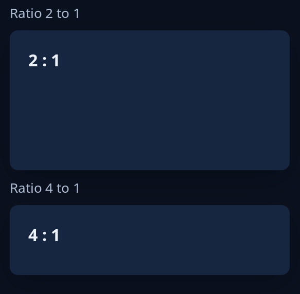

# Aspect

`aspect(ratio, inner)` keeps `inner` to a shape: the largest size of `ratio`, width over height, that fits the room it is given, in the middle of it. Use it for a picture or a video that must not be squeezed. In a column it asks for the height its shape needs at the width given.



For the other containers, see [layout](../guides/layout.md).

<!-- picture width 320 -->
```rust
use trindle_toolkit::widget::{aspect, card, column, heading, note, Node};

fn view() -> Node<()> {
    column(vec![
        note("Ratio 2 to 1"),
        aspect(2.0, card(heading("2 : 1"))),
        note("Ratio 4 to 1"),
        aspect(4.0, card(heading("4 : 1"))),
    ]).gap(8.0).padding(24.0)
}
# let _ = view();
```
