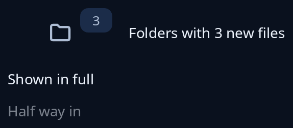

# Badged and revealer

`frames::badged(inner, badge, corner)` lays a badge (a count or a state dot) over one corner of `inner`, on purpose, taking no room of its own. `Corner` is `TopStart`, `TopEnd`, `BottomStart` or `BottomEnd`. `frames::revealer(inner, share)` shows `inner` `share` of the way, from 0 to 1, fading in; at 0 it is gone and takes no room. The program moves `share` with `motion::tween`, which jumps straight to the end for anyone who asked for less movement.



**The screen reader hears:** both the badged item and the badge's words. A revealer at 0 is not heard or reached by the keyboard at all; between 0 and 1 it is heard and reached as usual.

<!-- picture width 320 -->
```rust
use trindle_toolkit::frames::{badged, revealer, Corner};
use trindle_toolkit::widget::{button, card, column, label, note, row, Node};

fn view() -> Node<()> {
    column(vec![
        row(vec![
            badged(button("folder-symbolic", "Folders").size(48.0).on_press(()), card(note("3")).chip(), Corner::TopEnd),
            label("Folders with 3 new files"),
        ]).gap(16.0),
        revealer(label("Shown in full"), 1.0),
        revealer(label("Half way in"), 0.5),
    ]).gap(12.0).padding(24.0)
}
# let _ = view();
```
