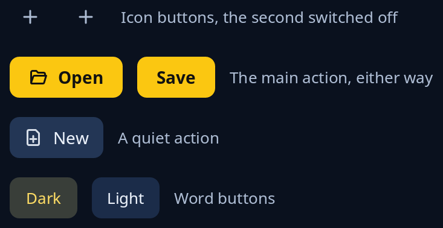

# Buttons

A button sends a message when pressed. `button` is a round icon button, `main_action` and `main_word` are the screen's one main action in the highlight, `quiet_action` is a worded button a step lighter than the page, and `word_button` is a small pill of one word that can show it is the one in use.



**Keys:** Tab reaches a button, then Space or Enter presses it. A button switched off with `.off(true)` is skipped.

**The screen reader hears:** a button named by its tip, or by its words for the worded ones. A button that is switched off, or has no press, is told as disabled, and a word button given `.on(..)` is told as on or off.

Which one to use when, and `.on_press`, `.on` and `.off`, are in [buttons](../guides/buttons.md).

<!-- picture width 440 -->
```rust
use trindle_toolkit::widget::{button, column, main_action, main_word, note, quiet_action, row, word_button, Node};

#[derive(Clone)]
enum Msg {
    Add,
    Open,
    Save,
    New,
    Dark(bool),
}

fn view() -> Node<Msg> {
    column(vec![
        row(vec![
            button("list-add-symbolic", "Add").on_press(Msg::Add),
            button("list-add-symbolic", "Add, not now").on_press(Msg::Add).off(true),
            note("Icon buttons, the second switched off"),
        ]).gap(12.0),
        row(vec![
            main_action("document-open-symbolic", "Open").on_press(Msg::Open),
            main_word("Save").on_press(Msg::Save),
            note("The main action, either way"),
        ]).gap(12.0),
        row(vec![
            quiet_action("document-new-symbolic", "New").on_press(Msg::New),
            note("A quiet action"),
        ]).gap(12.0),
        row(vec![
            word_button("Dark").on(true).on_press(Msg::Dark(true)),
            word_button("Light").on_press(Msg::Dark(false)),
            note("Word buttons"),
        ]).gap(12.0),
    ]).gap(16.0).padding(24.0)
}
# let _ = view();
```
