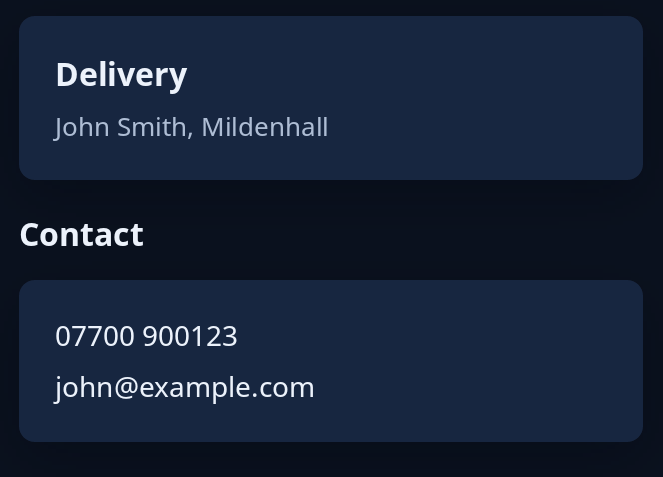

# Card and frame

`card` is a panel raised off the window, holding one item; put a column inside it for several. `frames::frame` is a card under a name, for things that belong together. Give a card `.on_press(msg)` and the whole card is pressed like a button.



**Keys:** a card with a press is reached by Tab and pressed with Space or Enter; a plain card and a frame take no keys.

**The screen reader hears:** a plain card as a group; a pressable card as a button named by the words inside it. A frame's name is a heading, level 3.

For the other containers, see [layout](../guides/layout.md).

<!-- picture width 360 -->
```rust
use trindle_toolkit::frames::frame;
use trindle_toolkit::widget::{card, column, heading, label, note, Node};

fn view() -> Node<()> {
    column(vec![
        card(column(vec![heading("Delivery"), note("John Smith, Mildenhall")]).gap(6.0)),
        frame("Contact", column(vec![label("07700 900123"), label("john@example.com")]).gap(6.0)),
    ]).gap(16.0).padding(24.0)
}
# let _ = view();
```
