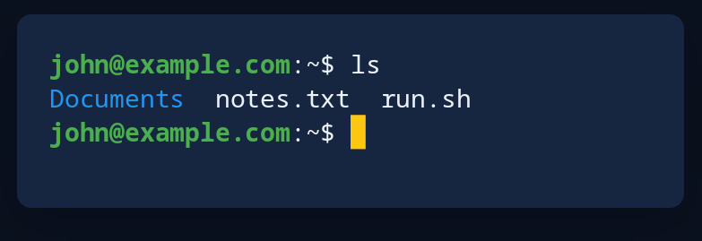

# Cell grid and terminal

`cellgrid::Screen` is a grid of cells painted as a terminal does: each cell has its character, colours and marks, and a wide character takes two cells. `put(col, row, text, &look)` writes words, `paint_cells` paints the grid with a cursor and a selection over it. `term::Term` is a terminal's screen fed by a program: `feed(bytes)` takes words, line ends and ANSI colours and marks, scrolls into a scroll-back (`scroll(lines)` moves through it), and `paint_term` paints it.



**Keys:** none of its own. The program gives the keys; `examples/cells.rs` answers Ctrl+Shift+C to copy, Ctrl+Shift+V to paste and Ctrl+G for the bell.

**The screen reader hears:** a terminal with the lines in view and the cursor, when the drawing is given `.reads(term.reading())`. Never give it words from a secret box.

`cellgrid::cell_metrics` gives the size of one cell, so a drawing can be made as many columns and rows as it needs.

<!-- picture width 420 -->
```rust
use trindle_toolkit::term::{paint_term, Term};
use trindle_toolkit::widget::{card, column, drawing, Node};

fn view() -> Node<()> {
    let mut term = Term::new(30, 3);
    term.feed(
        b"\x1b[1;32mjohn@example.com\x1b[0m:~$ ls\r\n\
          \x1b[34mDocuments\x1b[0m  notes.txt  run.sh\r\n\
          \x1b[1;32mjohn@example.com\x1b[0m:~$ ",
    );
    let reading = term.reading();
    column(vec![
        card(
            drawing((340.0, 72.0), "Terminal", move |canvas, pen| paint_term(canvas, pen, &term, 14.0, true)).reads(reading),
        ),
    ]).padding(24.0)
}
# let _ = view();
```
