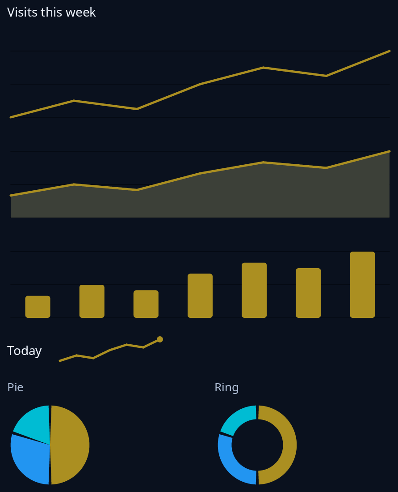

# Charts

`Chart` draws numbers as a line, an area, columns, a small spark line, a pie or a ring, all in the sheet's colours. Build one with the kind you want, then turn it into a node with `node`. `labels` names each value or part, `tall` sets the height in points, and `hovering` sends the value the pointer is on (or `None` when it leaves).



**The screen reader hears:** the name, the kind of chart and the figures, such as "Visits: line chart, 3 values, first 3, last 5, lowest 3, highest 8". A pie or ring says each part with its share.

<!-- picture width 480 -->
```rust
use trindle_toolkit::charts::Chart;
use trindle_toolkit::widget::{column, label, note, row, Length, Node};

fn view() -> Node<()> {
    let visits = [12.0, 18.0, 15.0, 24.0, 30.0, 27.0, 36.0];
    let spend = [50.0, 30.0, 20.0];
    let parts = || vec!["Rent".to_string(), "Food".to_string(), "Other".to_string()];
    column(vec![
        label("Visits this week"),
        Chart::line("Visits", &visits).tall(96.0).node(),
        Chart::area("Visits", &visits).tall(96.0).node(),
        Chart::columns("Visits", &visits).tall(96.0).node(),
        row(vec![
            label("Today"),
            Chart::spark("Visits", &visits).node().width(Length::Fixed(120.0)),
        ]).gap(16.0),
        row(vec![
            column(vec![note("Pie"), Chart::pie("Spending", &spend).labels(parts()).tall(96.0).node()]).gap(8.0),
            column(vec![note("Ring"), Chart::ring("Spending", &spend).labels(parts()).tall(96.0).node()]).gap(8.0),
        ]).gap(32.0),
    ]).gap(16.0).padding(24.0)
}
# let _ = view();
```
