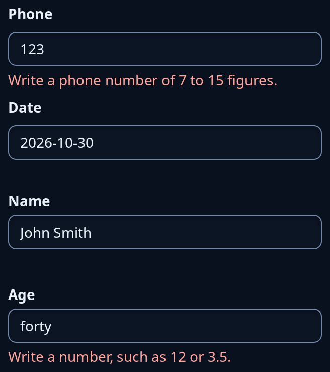

# Checked box and form

`validate::CheckedBox` is a text box that refuses what cannot be in it: a phone number, a date written 2026-10-30 or a hex colour. What is wrong is said in red words under the box once the keyboard has left it, in a line kept for them so nothing moves. `form::Form` is a form tied to a record of your own: each field reads its text from the record and writes it back as it is typed, and a field's refused value is said under its box.



**Keys:** The same as [entry](entry.md); the boxes are text boxes.

**The screen reader hears:** a text box called by the tip (a form's box by its field name), with the red words as text under it.

`CheckedBox` and `Form` keep their state in your program; give each message to `update`.

<!-- picture width 360 -->
```rust
use trindle_toolkit::form::{Form, Typed};
use trindle_toolkit::validate::{CheckedBox, Edit, Mask};
use trindle_toolkit::widget::{column, form_label, Node};

#[derive(Clone)]
enum Msg {
    Phone(Edit),
    Date(Edit),
    Person(Typed),
}

struct Person {
    name: String,
    age: f64,
}

fn view() -> Node<Msg> {
    let phone = CheckedBox { left: true, ..CheckedBox::new(Mask::Phone, "123") };
    let date = CheckedBox { left: true, ..CheckedBox::new(Mask::Date, "2026-10-30") };
    let mut person = Person { name: "John Smith".into(), age: 40.0 };
    let mut form = Form::new()
        .text("Name", |p: &Person| p.name.clone(), |p, s| if s.trim().is_empty() { Err("Write a name.") } else { p.name = s.into(); Ok(()) })
        .number("Age", |p| p.age, |p, n| p.age = n);
    form.load(&person);
    form.update(Typed { field: 1, text: "forty".into() }, &mut person);
    column(vec![
        form_label("Phone"),
        phone.view("Phone", Msg::Phone),
        form_label("Date"),
        date.view("Date", Msg::Date),
        form.view(Msg::Person),
    ]).gap(8.0).padding(24.0)
}
# let _ = view();
```
