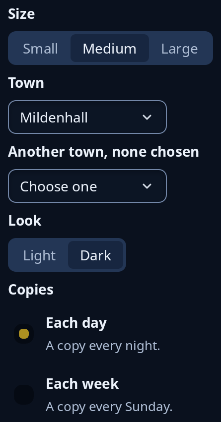

# Choices and dropdowns

Four ways to pick one answer. `choice` is a strip of a few short answers, `dropdown` a closed list that opens over the page and moves nothing, `one_of` picks between those two for you from the answers, and `tiles::radio_group` is rows that each carry a line of explanation. A dropdown with nothing chosen says "Choose one".



**Keys:** In a strip, Left and Right (or Up and Down) move the choice, and Home and End go to the ends. A dropdown opens with Space, Enter, Up or Down; in the list Up, Down, Page Up, Page Down, Home and End move, Enter or Space picks and Escape closes it. A list too long to show whole has a search box that typing narrows. In radio rows Tab stops on the chosen row, and the arrows, Home and End move the choice.

**The screen reader hears:** a strip as a radio group called by the tip, each answer a radio button, the chosen one on. A dropdown is a combo box called by the tip with the chosen answer as its value, and open or closed. Each radio row is a radio button saying its name, then its line.

The whole family, with switches and sliders, is in [choices](../guides/choices.md).

<!-- picture width 360 -->
```rust
use trindle_toolkit::tiles::radio_group;
use trindle_toolkit::widget::{choice, column, dropdown, form_label, one_of, Node};

#[derive(Clone)]
enum Msg {
    Size(usize),
    Town(usize),
    Look(usize),
    Copies(usize),
}

fn view() -> Node<Msg> {
    let sizes = vec!["Small".to_string(), "Medium".to_string(), "Large".to_string()];
    let towns = vec!["Ely".to_string(), "Thetford".to_string(), "Mildenhall".to_string()];
    let looks = vec!["Light".to_string(), "Dark".to_string()];
    let copies = vec![
        ("Each day".to_string(), "A copy every night.".to_string()),
        ("Each week".to_string(), "A copy every Sunday.".to_string()),
    ];
    column(vec![
        form_label("Size"),
        choice(sizes, 1, "Size", Msg::Size),
        form_label("Town"),
        dropdown(towns.clone(), Some(2), "Town", Msg::Town),
        form_label("Another town, none chosen"),
        dropdown(towns, None, "Another town", Msg::Town),
        form_label("Look"),
        one_of(looks, Some(1), "Look", Msg::Look),
        form_label("Copies"),
        radio_group(copies, 0, Msg::Copies),
    ]).gap(8.0).padding(24.0)
}
# let _ = view();
```
