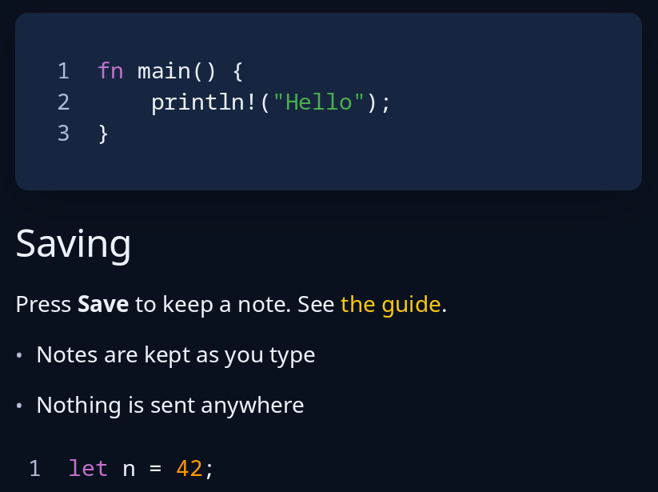

# Code and help views

`code::view(text, lang, name)` is read-only code with line numbers down the side and colours from the style sheet; `Lang` is `Rust`, `Shell` or `Plain` (`Lang::guess` picks one from a file's name). It asks for room for its longest line, so put it in a `scroll_x` where lines may be long. `help::view(&blocks, follow)` is a help page: read the blocks from simple markdown with `help::markdown` or from simple HTML with `help::html`, and every link sends `follow` its address.



**The screen reader hears:** code as a read-only text area with the name you give it, each line read in turn. A help page's headings as headings, each paragraph with its links as links it can follow, and its code under the name "Code".

<!-- picture width 440 -->
```rust
use trindle_toolkit::code::{self, Lang};
use trindle_toolkit::help;
use trindle_toolkit::widget::{card, column, Node};

#[derive(Clone)]
enum Msg {
    Open(String),
}

fn view() -> Node<Msg> {
    let page = help::markdown("## Saving\n\nPress **Save** to keep a note. See [the guide](guide.md).\n\n- Notes are kept as you type\n- Nothing is sent anywhere\n\n```rust\nlet n = 42;\n```");
    column(vec![
        card(code::view("fn main() {\n    println!(\"Hello\");\n}", Lang::Rust, "main.rs")),
        help::view(&page, Msg::Open),
    ]).gap(16.0).padding(24.0)
}
# let _ = view();
```
