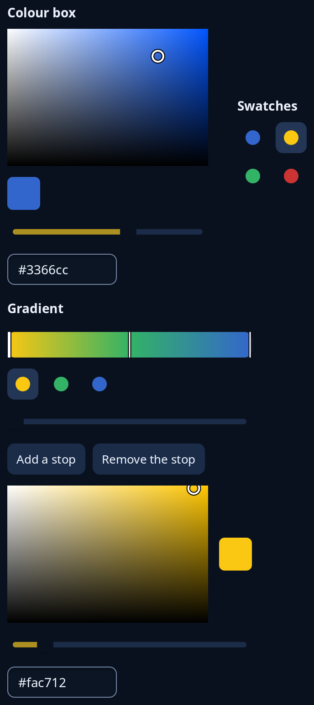

# Colour pickers

`picker::ColourBox` picks a colour from a square of saturation and brightness, a hue slider and a box for the hex code, with a swatch of the colour chosen. `picker::swatch_grid` is a grid of colours to press, the chosen one lit. `picker::GradientBox` edits a gradient of two or more stops: the bar, a swatch for each stop, a slider for where the chosen stop lies, Add and Remove buttons, and a colour box for the stop's colour.



**Keys:** In the square, Left and Right change saturation and Up and Down change brightness. The hue and place sliders take the slider keys (see [sliders](sliders.md)), the hex box takes the entry keys, and swatches and buttons are reached by Tab and pressed with Space or Enter.

**The screen reader hears:** the square as "Colour, saturation and brightness", the swatch as "Chosen colour" and its code, a slider called "Hue" and a text box called "Hex code". Each swatch in a grid is a button named by its hex code. A gradient bar is told as "Gradient with 3 stops".

`ColourBox` and `GradientBox` keep their state in your program; give each message to `update`. The button that opens a picker is `buttons::colour_button`.

<!-- picture width 520 -->
```rust
use trindle_toolkit::colour::Colour;
use trindle_toolkit::picker::{swatch_grid, ColourBox, Edit, GradientBox, Shade};
use trindle_toolkit::widget::{column, form_label, row, Node};

#[derive(Clone)]
enum Msg {
    Colour(Edit),
    Swatch(usize),
    Gradient(Shade),
}

fn view() -> Node<Msg> {
    let blue = Colour::rgb(0.2, 0.4, 0.8);
    let yellow = Colour::rgb(0.98, 0.78, 0.07);
    let green = Colour::rgb(0.2, 0.7, 0.4);
    let red = Colour::rgb(0.8, 0.2, 0.2);
    let gradient = GradientBox::new(vec![(0.0, yellow), (0.5, green), (1.0, blue)]).unwrap();
    column(vec![
        row(vec![
            column(vec![form_label("Colour box"), ColourBox::new(blue).view(Msg::Colour)]).gap(8.0),
            column(vec![form_label("Swatches"), swatch_grid(&[blue, yellow, green, red], Some(1), 2, Msg::Swatch)]).gap(8.0),
        ]).gap(32.0),
        form_label("Gradient"),
        gradient.view(Msg::Gradient),
    ]).gap(16.0).padding(24.0)
}
# let _ = view();
```
