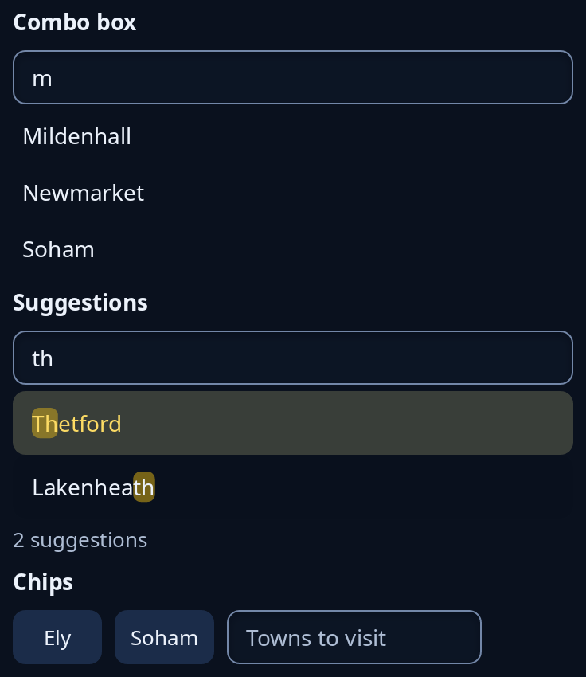

# Combo boxes

A typing box with help under it, never floating over the page. `combo::combo` shows the answers that contain what is typed, and typing or pressing one sends the same string. `complete::Complete` shows suggestions in a list, the ones that start with the typing first, with the typing marked in each. `chips::Chips` turns each word entered into a chip you can press to remove.



**Keys:** In a combo box, Tab reaches the answers under the box, and Space or Enter takes one. With suggestions, Up and Down go through them and round again, Enter takes the lit one and Escape hides them until something is typed. In chips, Enter makes a chip of the typing, and Backspace in the empty box takes the last chip away.

**The screen reader hears:** a text box called by the tip, each answer under a combo box by its words. A box with suggestions is a combo box, and says how many suggestions there are ("2 suggestions"). Each chip is a button called "Remove" and its word.

`Complete` and `Chips` keep a small state in your program; give each message to `update`.

<!-- picture width 400 -->
```rust
use trindle_toolkit::chips::{Chips, Edit};
use trindle_toolkit::combo::combo;
use trindle_toolkit::complete::{Complete, Did};
use trindle_toolkit::widget::{column, form_label, Node};

#[derive(Clone)]
enum Msg {
    Town(String),
    Suggest(Did),
    Chips(Edit),
}

fn view() -> Node<Msg> {
    let towns: Vec<String> = ["Mildenhall", "Brandon", "Ely", "Thetford", "Newmarket", "Lakenheath", "Soham"]
        .iter().map(|t| t.to_string()).collect();
    let suggest = Complete { text: "th".into(), lit: Some(0), open: true };
    let chips = Chips { chips: vec!["Ely".into(), "Soham".into()], draft: String::new() };
    column(vec![
        form_label("Combo box"),
        combo("m", &towns, "Town", Msg::Town),
        form_label("Suggestions"),
        suggest.view("town", "Town", &towns, Msg::Suggest),
        form_label("Chips"),
        chips.view("Towns to visit", Msg::Chips),
    ]).gap(8.0).padding(24.0)
}
# let _ = view();
```
