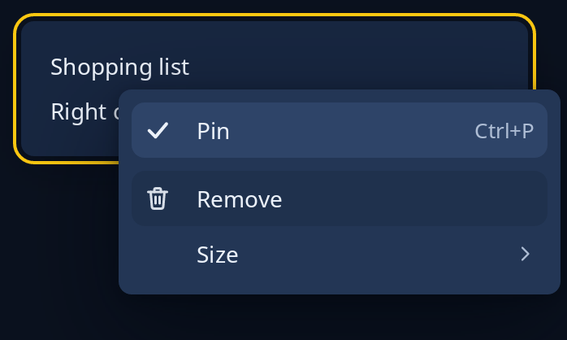

# Context menu

`.context_menu(rows)` gives any widget, and everything in it, a small menu that floats over the window and moves nothing. The closure is asked each time the menu opens, so its rows can follow the program's state. The nearest menu round a widget is the one that opens. A text box keeps its own Cut, Copy and Paste, a list or drawing with a menu of its own keeps that, and a greyed out widget offers nothing.



**Keys:** the Menu key or Shift+F10 opens it under the widget the keyboard is on, with its first row lit. Up and Down move along it, Right opens a sub-menu, Return chooses and Escape shuts it. A letter typed lights the next row that starts with it. A right click, or a finger held still, opens it where it fell.

**The screen reader hears:** a menu, which a screen reader can also open.

A row is `MenuRow::send(icon, words, msg)`, or `MenuRow::copy(text)` to put words on the clipboard. Add `.keys("Ctrl+P")` to show the keys that do the same, `.checked(on)` for a tick, `.radio(on)` for a dot, `.rule()` for a line above it and `.submenu(rows)` for a sub-menu. See [popup menu](popup-menu.md) for a menu you open yourself.

<!-- picture width 360 height 220 keys Tab,Menu -->
```rust
use trindle_toolkit::widget::{card, column, label, MenuRow, Node};

#[derive(Clone)]
enum Msg {
    Pin(bool),
    Remove,
    Size(u32),
}

fn view() -> Node<Msg> {
    let pinned = true;
    let note = card(column(vec![label("Shopping list"), label("Right click for more")]).gap(8.0))
        .on_press(Msg::Pin(!pinned))
        .context_menu(move || vec![
            MenuRow::send("starred-symbolic", "Pin", Msg::Pin(!pinned)).checked(pinned).keys("Ctrl+P"),
            MenuRow::send("user-trash-symbolic", "Remove", Msg::Remove).rule(),
            MenuRow::send("", "Size", Msg::Size(0)).submenu(vec![MenuRow::send("", "Small", Msg::Size(12)), MenuRow::send("", "Large", Msg::Size(18))]),
        ]);
    column(vec![note]).padding(24.0)
}
# let _ = view();
```
