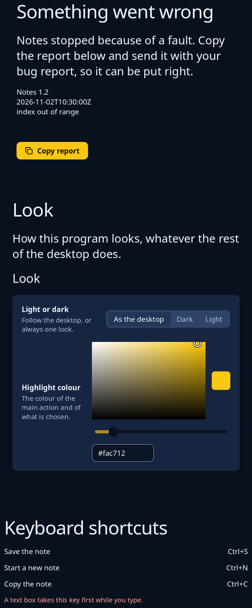

# Crash, look and shortcuts pages

Three ready-made pages. `crash::page` is shown after a fault: what happened in plain words, the report in a scrolling box, and a Copy report button that sends your message so the program can put the report on the clipboard. `settings::look_page` changes a program's own look: light, dark or as the desktop, and the highlight colour, with a button to give it back to the desktop. `shortcuts::Shortcuts::page` lists every shortcut bound, what it does beside its keys, with a line in the problem tone under a key the toolkit takes first.



**Keys:** the crash page's button and the look page's choices answer to Tab, then Space or Enter or the arrows. The shortcuts page has nothing to press.

**The screen reader hears:** the titles and sentences as words, the report as words, and the button as Copy report. On the look page each setting's control tells its own role and name.

Give each `LookEdit` to `LookChoice::apply` and save the choice with `LookChoice::save`. `crash::install` writes the report when the program panics and `crash::take` finds it at the next start.

<!-- picture width 520 -->
```rust
use trindle_toolkit::colour::Colour;
use trindle_toolkit::crash;
use trindle_toolkit::picker::ColourBox;
use trindle_toolkit::settings::{look_page, LookChoice, LookEdit};
use trindle_toolkit::shortcuts::Shortcuts;
use trindle_toolkit::widget::{column, Length, Node};

#[derive(Clone)]
enum Msg {
    Copy,
    Look(LookEdit),
}

fn view() -> Node<Msg> {
    let report = "Notes 1.2\n2026-11-02T10:30:00Z\nindex out of range";
    let mut keys = Shortcuts::new();
    let _ = keys.bind("Ctrl+S", "Save the note");
    let _ = keys.bind("Ctrl+N", "Start a new note");
    let _ = keys.bind("Ctrl+C", "Copy the note");
    column(vec![
        crash::page("Notes", report, Msg::Copy).height(Length::Fixed(360.0)),
        look_page(&LookChoice::default(), &ColourBox::new(Colour::rgb(0.98, 0.78, 0.07)), Msg::Look).height(Length::Fixed(600.0)),
        keys.page(|action| action.to_string()),
    ]).gap(32.0).padding(24.0)
}
# let _ = view();
```
