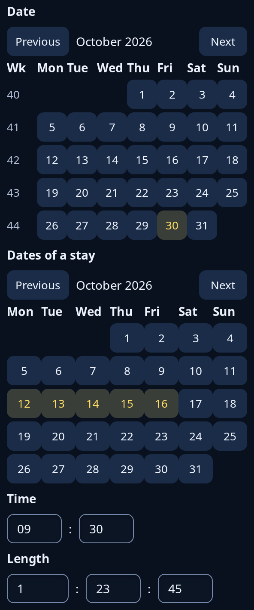

# Date and time boxes

`when::DateBox` is a month grid with one day chosen, and Previous and Next buttons for the month; ask for each week's ISO number down its left with `weeks`. `when::RangeBox` is the same grid for a first and a last day, with every day between filled in. `when::TimeBox` is hours and minutes typed in two small boxes, and `duration::DurationBox` is hours, minutes and seconds.



**Keys:** Tab reaches each day and the month buttons, and Space or Enter presses one. The time and length boxes take the entry keys (see [entry](entry.md)) and keep only figures: two for minutes, seconds and the time's hours, four for a length's hours.

**The screen reader hears:** each day as a full date, such as "Friday 30 October 2026", with the chosen days on, and each week number as "Week" and the number. The boxes are text boxes called "Hours", "Minutes" and, for a length, "Seconds".

In a range, the first press picks the first day and the next, on or after it, the last; a press before it starts again, and a press once both are chosen starts a new range. Each box keeps its state in your program; give each message to `update`, and read the result from the `chosen` field of a `DateBox`, the `from` and `to` of a `RangeBox`, `TimeBox::time` or `DurationBox::total`.

<!-- picture width 360 -->
```rust
use trindle_toolkit::{duration, when};
use trindle_toolkit::widget::{column, form_label, Node};

#[derive(Clone)]
enum Msg {
    Day(when::Pick),
    Range(when::Pick),
    Time(when::Typed),
    Length(duration::Typed),
}

fn view() -> Node<Msg> {
    let today = when::Date::new(2026, 10, 30).unwrap();
    let days = when::DateBox { weeks: true, ..when::DateBox::new(Some(today), today) };
    let stay = when::RangeBox {
        from: when::Date::new(2026, 10, 12),
        to: when::Date::new(2026, 10, 16),
        ..when::RangeBox::new(today)
    };
    column(vec![
        form_label("Date"),
        days.view(Msg::Day),
        form_label("Dates of a stay"),
        stay.view(Msg::Range),
        form_label("Time"),
        when::TimeBox::new(when::Time::new(9, 30).unwrap()).view(Msg::Time),
        form_label("Length"),
        duration::DurationBox::new(5025).view(Msg::Length),
    ]).gap(8.0).padding(24.0)
}
# let _ = view();
```
