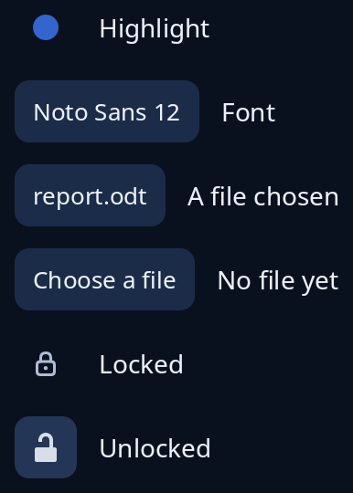

# Colour, font, file and lock buttons

Buttons that show the current answer and send a message when pressed, so your program can open the colour picker, the font page or the file page. `colour_button` is filled with the colour, `font_button` says the family and size, `file_button` gives the file's name or asks for one, and `lock_button` is a lock over settings that need leave to change.



**Keys:** Tab reaches each, then Space or Enter presses it.

**The screen reader hears:** a button. The colour button says its tip and the colour's code, the font and file buttons say the tip and then what they show, and a shut lock says "Unlock to make changes" while an open one says "Lock to stop changes" and is told as on.

The pages these open are `picker::ColourBox`, `font_page::FontPage` and `file_page::FilePage`.

<!-- picture width 360 -->
```rust
use std::path::Path;

use trindle_toolkit::buttons::{colour_button, file_button, font_button, lock_button};
use trindle_toolkit::colour::Colour;
use trindle_toolkit::widget::{column, label, row, Node};

#[derive(Clone)]
enum Msg {
    Colour,
    Font,
    File,
    Lock,
}

fn view() -> Node<Msg> {
    column(vec![
        row(vec![colour_button(Colour::rgb(0.2, 0.4, 0.8), "Highlight", Msg::Colour), label("Highlight")]).gap(12.0),
        row(vec![font_button("Noto Sans", 12.0, "Font", Msg::Font), label("Font")]).gap(12.0),
        row(vec![file_button(Some(Path::new("/home/john/report.odt")), "Report", Msg::File), label("A file chosen")]).gap(12.0),
        row(vec![file_button(None, "Report", Msg::File), label("No file yet")]).gap(12.0),
        row(vec![lock_button(true, Msg::Lock), label("Locked")]).gap(12.0),
        row(vec![lock_button(false, Msg::Lock), label("Unlocked")]).gap(12.0),
    ]).gap(12.0).padding(24.0)
}
# let _ = view();
```
