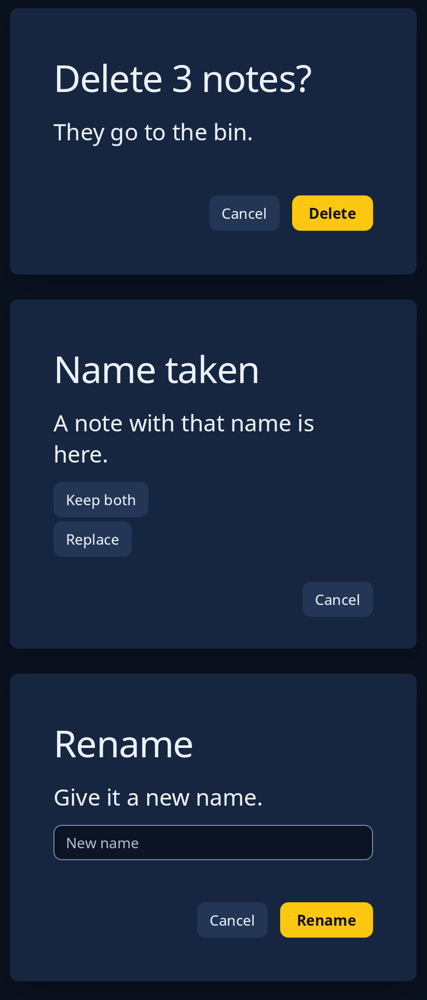

# Dialog

A dialog here is a whole page shown in place of the window's page, never over it: its title, a sentence under it, what it holds, and the answers at the foot, with Cancel always first. Nothing else can be reached while it shows, so the keyboard stays in it. `dialog::confirm` asks a yes or no, `dialog::choose` offers several answers as buttons under the message, and `dialog::ask` takes an answer typed in a box. For anything else build one with `dialog::dialog(title, lead, cancel)`, then `holds(node)` for what it holds, `answer(node)` for each answer (the last is the main one) and `node()`.

`turn` is a number the program counts up each time the dialog opens; each time it goes past the last one given, the keyboard is put on Cancel, the safer answer (or in the box, when asking).



**Keys:** the keyboard starts on Cancel, or in the box when asking; Tab moves to the other answers, and Enter or Space presses the button. In `ask`, Enter in the box answers. Escape cancels.

**The screen reader hears:** a dialog named by its title, with its sentence and buttons; the box in `ask` by its hint.

<!-- picture width 440 -->
```rust
use trindle_toolkit::dialog::{ask, choose, confirm};
use trindle_toolkit::widget::{card, column, Length, Node};

#[derive(Clone)]
enum Msg {
    Cancel,
    Delete,
    Keep,
    Replace,
    Name(String),
    Rename,
}

fn view() -> Node<Msg> {
    let options = vec![("Keep both".to_string(), Msg::Keep), ("Replace".to_string(), Msg::Replace)];
    column(vec![
        card(confirm("Delete 3 notes?", "They go to the bin.", "Delete", Msg::Delete, Msg::Cancel, 0).height(Length::Fixed(220.0))),
        card(choose("Name taken", "A note with that name is here.", options, Msg::Cancel, 0).height(Length::Fixed(300.0))),
        card(ask("Rename", "Give it a new name.", "", "New name", Msg::Name, "Rename", Msg::Rename, Msg::Cancel, 0).height(Length::Fixed(260.0))),
    ]).gap(24.0).padding(24.0)
}
# let _ = view();
```
