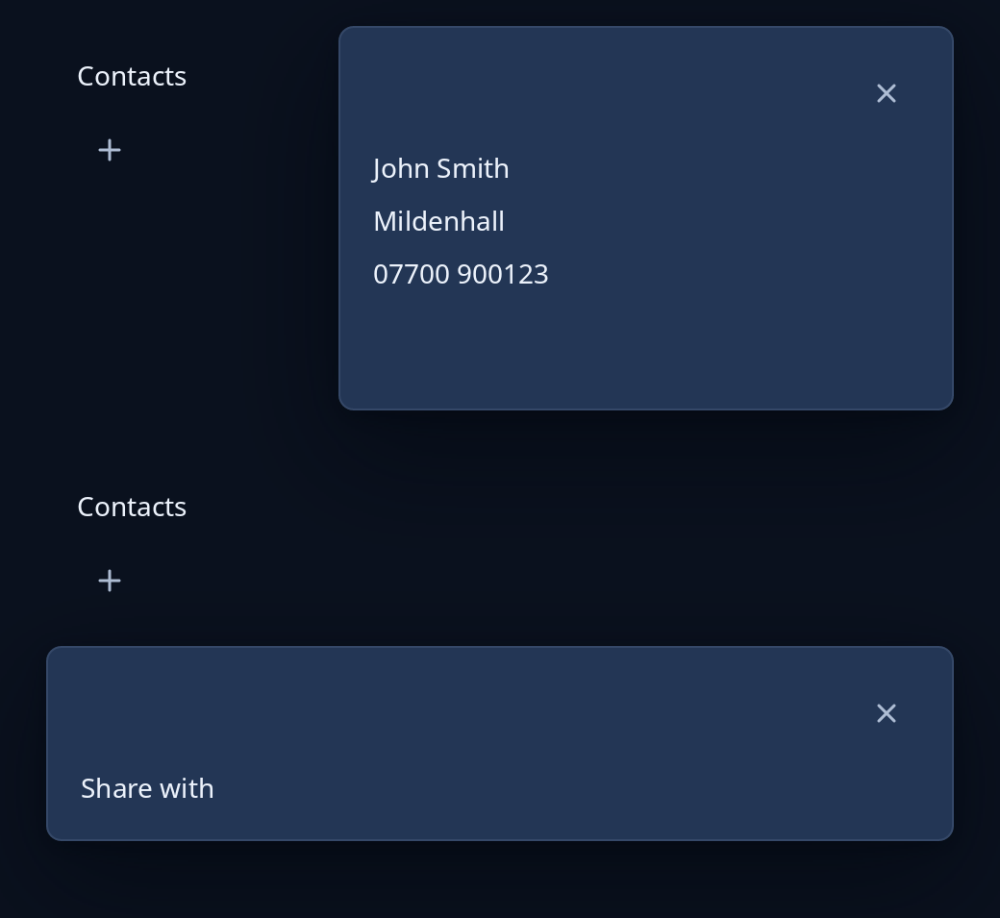

# Drawer and bottom sheet

`nav::drawer` lays a panel over one edge of a page, as a side bar on a narrow window or a context drawer. `nav::bottom_sheet` lays a panel over the foot of a page, as tall as it needs. Both float on a card with a Close the panel button, and neither is a pop-up: the page beside a drawer can still be used. While `open` is false the page is returned as it is.



**Keys:** Escape shuts the panel by sending `shut`, as the button does.

**The screen reader hears:** the panel's own words, and a button named "Close the panel".

The drawer is `--trindle-drawer-width` wide but always leaves `--trindle-drawer-room` of the page uncovered; pass the window's width so it can work that out.

<!-- picture width 520 -->
```rust
use trindle_toolkit::nav::{self, Edge};
use trindle_toolkit::widget::{button, column, label, Length, Node};

#[derive(Clone)]
enum Msg {
    Shut,
    Add,
}

fn page() -> Node<Msg> {
    column(vec![
        label("Contacts"),
        button("list-add-symbolic", "Add a contact").on_press(Msg::Add),
    ]).gap(12.0).padding(16.0)
}

fn view() -> Node<Msg> {
    let details = column(vec![label("John Smith"), label("Mildenhall"), label("07700 900123")]).gap(8.0);
    column(vec![
        nav::drawer(page(), details, true, Edge::End, 520.0, Msg::Shut).height(Length::Fixed(200.0)),
        nav::bottom_sheet(page(), label("Share with"), true, Msg::Shut).height(Length::Fixed(200.0)),
    ]).gap(24.0).padding(24.0)
}
# let _ = view();
```
