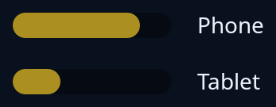

# Drawing

`drawing(size, tip, paint)` is a space you paint yourself, and the start of any widget the toolkit does not have. `paint` gets the canvas and a `Pen` (theme, fonts, icons, scale) each time the window is painted. `tiles::Sketch::fit` gives you a box of your own units and the theme's colours (`highlight`, `track`, `boxed`, `words`, `quiet`), so the widget follows light, dark and the person's highlight with no colour written in the code.



**The screen reader hears:** an image named by `tip`, unless you give it another role. Here `.role(Role::Meter { .. })` makes it a meter with its number, and `.value(..)` gives the words read in place of the number.

The pointer, the keyboard, the wheel, a menu and other roles are added with methods on the node: see [your own kind of widget](../guides/custom-widgets.md). To record the drawing as a list of shapes instead of painting at once, see [painter](painter.md).

<!-- picture width 320 -->
```rust
use trindle_toolkit::role::Role;
use trindle_toolkit::tiles::Sketch;
use trindle_toolkit::widget::{column, drawing, label, row, Node};

fn level(name: &'static str, percent: u32) -> Node<()> {
    drawing((100.0, 16.0), name, move |canvas, pen| {
        let mut s = Sketch::fit(canvas, pen, (100.0, 16.0));
        let (track, mark) = (s.track(), s.highlight());
        s.rect((0.0, 0.0, 100.0, 16.0), 8.0, track);
        s.rect((0.0, 0.0, percent as f32, 16.0), 8.0, mark);
    })
    .role(Role::Meter { value: f64::from(percent), min: 0.0, max: 100.0 })
    .value(format!("{percent} per cent"))
}

fn view() -> Node<()> {
    column(vec![
        row(vec![level("Phone battery", 80), label("Phone")]).gap(16.0),
        row(vec![level("Tablet battery", 30), label("Tablet")]).gap(16.0),
    ]).gap(16.0).padding(24.0)
}
# let _ = view();
```
