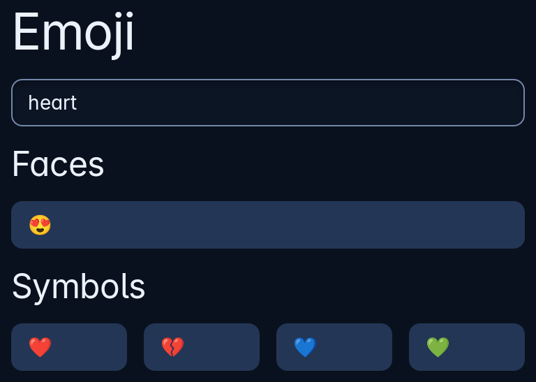

# Emoji picker

`emoji_picker::emoji_page` is a page of emoji in eight groups (faces, hands, animals, nature, food, travel, objects and symbols), each under its group's name, with a box to find them by name in the person's language. Your state keeps what is typed in the box; pressing an emoji sends it as a string for you to put where it belongs. A name nothing has shows "No emoji has that name."



**Keys:** Type in the box to narrow the page, then Tab reaches each emoji and Space or Enter presses it.

**The screen reader hears:** the box called "Find an emoji by name", and each emoji by its name, such as "Heart".

<!-- picture width 400 -->
```rust
use trindle_toolkit::emoji_picker::emoji_page;
use trindle_toolkit::widget::{column, Node};

#[derive(Clone)]
enum Msg {
    Search(String),
    Pick(String),
}

fn view() -> Node<Msg> {
    column(vec![emoji_page("heart", Msg::Search, Msg::Pick)]).padding(16.0)
}
# let _ = view();
```
