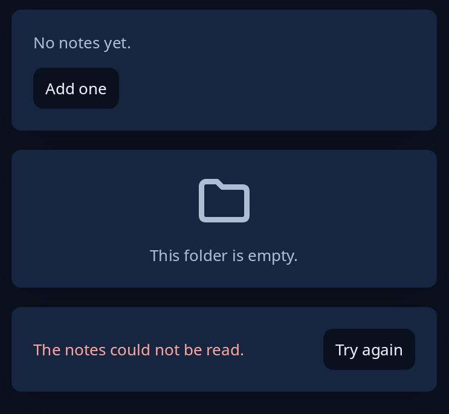

# Empty and error states

What a list, chart or data card shows when it has nothing to show. `tiles::empty_state` is a quiet sentence and, if there is one, the one next step. `tiles::empty_picture` adds a large quiet icon over the sentence, all in the middle. `tiles::error_state` is for what could not be read: red words in plain language and the button that tries again. Give each one next step at most, as a button you build.



**Keys:** the button answers to Tab, then Space or Enter.

**The screen reader hears:** the sentence as words and the button by its name.

For a whole page with one thing to say, see `pages::status_page` in [welcome, status and about pages](welcome-status-about.md).

<!-- picture width 400 -->
```rust
use trindle_toolkit::tiles::{empty_picture, empty_state, error_state};
use trindle_toolkit::widget::{card, column, word_button, Node};

#[derive(Clone)]
enum Msg {
    Add,
    Retry,
}

fn view() -> Node<Msg> {
    column(vec![
        card(empty_state("No notes yet.", Some(word_button("Add one").on_press(Msg::Add)))),
        card(empty_picture("folder-symbolic", "This folder is empty.", None)),
        card(error_state("The notes could not be read.", word_button("Try again").on_press(Msg::Retry))),
    ]).gap(16.0).padding(24.0)
}
# let _ = view();
```
