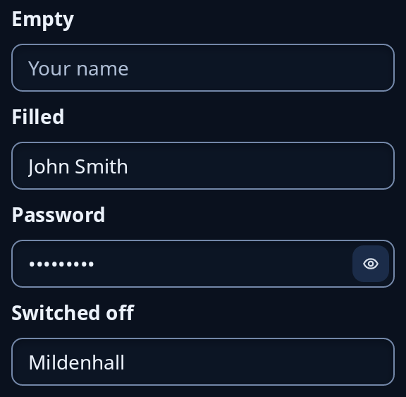

# Entry

`entry` is a one-line text box, or with `.lines(N)` a box at least `N` lines tall. Your state holds the text and every edit sends the whole new text. The tip shows faintly while the box is empty and is its name. `.secret()` makes it a password box (give it a `.key(..)` too, which the eye is kept by): dots in place of letters, nothing in it can be copied, and an eye at its right end that shows what is typed while it is on.



**Keys:** Left, Right, Home and End move the caret, Backspace and Delete remove, Enter sends `.on_submit`, Ctrl+A selects all, Ctrl+C, Ctrl+X and Ctrl+V copy, cut and paste, Ctrl+Z undoes and Ctrl+Y or Ctrl+Shift+Z redoes.

**The screen reader hears:** a text box called by the tip, holding the text. A password box is told as a password box with dots, never the letters, even while the eye shows them, and the eye is a button of its own.

The `.on_submit`, `.glow` and refused-value options are in [typing](../guides/typing.md). For a whole document see `editing::area::TextArea`.

## Many lines

`.lines(N)` makes the box at least `N` lines tall, in the same sunk look. Words wrap at the box's width, Enter starts a new line and Ctrl+Enter sends `.on_submit` (with none, it does nothing). Up and Down move by line, keeping the column where they can, and Home and End go to the ends of the line as drawn (Ctrl+Home and Ctrl+End to the ends of the text). The box grows with its words as far as its room allows, then scrolls to keep the caret in view. The mouse wheel scrolls the text by lines (the caret stays), and a selection dragged above or below the box scrolls it on while the pointer is held there. `N` is at least 1 and at most 100, and a paste is cut at 1 MiB. Undo, the input method and spelling marks work as in the one-line box, and a pasted text keeps its lines. A password box stays one line.

**The screen reader hears:** a multi-line text box called by the tip.

```rust
use trindle_toolkit::widget::{column, entry, Node};

#[derive(Clone)]
enum Msg {
    Doing(String),
    Send,
}

fn view(doing: &str) -> Node<Msg> {
    column(vec![
        entry(doing, "What were you doing?", Msg::Doing).lines(5).on_submit(Msg::Send),
    ]).padding(24.0)
}
# let _ = view("");
```

<!-- picture width 320 -->
```rust
use trindle_toolkit::widget::{column, entry, form_label, Node};

#[derive(Clone)]
enum Msg {
    Name(String),
    Town(String),
    Password(String),
}

fn view() -> Node<Msg> {
    column(vec![
        form_label("Empty"),
        entry("", "Your name", Msg::Name),
        form_label("Filled"),
        entry("John Smith", "Your name", Msg::Name),
        form_label("Password"),
        entry("sunflower", "Password", Msg::Password).secret().key("password"),
        form_label("Switched off"),
        entry("Mildenhall", "Town", Msg::Town).off(true),
    ]).gap(8.0).padding(24.0)
}
# let _ = view();
```
