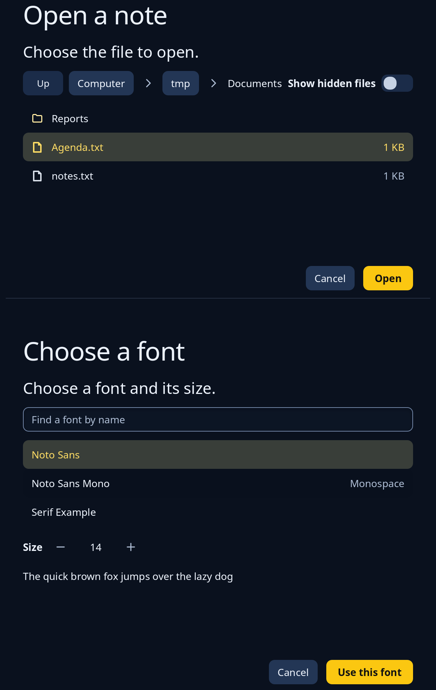

# File and font pages

`file_page::FilePage` is a file chooser as a page in the window, never a pop-up: the path as parts to press, an Up button, a switch for hidden files, one folder's folders and files, a box for the name when saving, and the answer. `font_page::FontPage` is the same for fonts: a box to find a family by name, the list, a size, and some words drawn in the chosen font. Both are shown in place of the window's page. The program keeps the page, feeds each step to `update`, and gets the answer back when it is final (a path, or a family and size).



**Keys:** in the list, the arrow keys, Page Up, Page Down, Home and End move the chosen row; Enter or a double click opens a folder or answers with a file (on the font page, answers with the family). When saving, Enter in the name box answers. Escape and Cancel send your cancel message.

**The screen reader hears:** a dialog named by its title; the list as "Folders and files" or "Fonts"; on the font page the sample as the words in the chosen family.

A file page reads a real folder, so the example makes one with made-up files first. Pass `Purpose::Save` to ask for a name, or `Purpose::Folder` to choose a folder. For the dialog around both, see [dialog](dialog.md).

<!-- picture width 640 -->
```rust
use trindle_toolkit::file_page::{FilePage, FileStep, Purpose};
use trindle_toolkit::font_page::{FontPage, FontStep};
use trindle_toolkit::text::FontFamily;
use trindle_toolkit::widget::{column, section_rule, Length, Node};

#[derive(Clone)]
enum Msg {
    File(FileStep),
    Font(FontStep),
    Cancel,
}

fn view() -> Node<Msg> {
    let folder = std::env::temp_dir().join("Documents");
    let _ = std::fs::create_dir_all(folder.join("Reports"));
    let _ = std::fs::write(folder.join("Agenda.txt"), "Monday");
    let _ = std::fs::write(folder.join("notes.txt"), "John Smith");
    let mut files = FilePage::new(Purpose::Open, folder);
    files.update(FileStep::Choose(1));
    let families: Vec<FontFamily> = [("Noto Sans", false), ("Noto Sans Mono", true), ("Serif Example", false)].into_iter()
        .map(|(name, monospace)| FontFamily { name: name.into(), faces: vec![(400, false)], monospace, colour: false })
        .collect();
    let fonts = FontPage::new(Some("Noto Sans".into()), 14.0);
    column(vec![
        files.view("Open a note", Msg::File, Msg::Cancel).height(Length::Fixed(420.0)),
        section_rule(),
        fonts.view(&families, "Choose a font", Msg::Font, Msg::Cancel).height(Length::Fixed(500.0)),
    ]).gap(24.0).padding(24.0)
}
# let _ = view();
```
