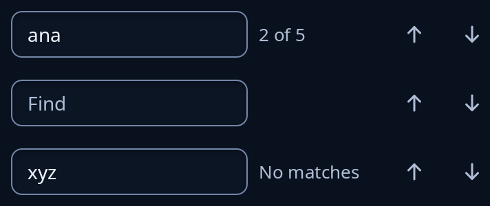

# Find bar

`find::Find` is a find bar: a typing box, words saying which match you are on ("2 of 5", or "No matches"), and buttons for the previous and the next match. The bar only counts and points; your program searches (`find::find_in` gives the places in a text), tells it how many there are with `set_count` and marks the match shown. Escape sends `Edit::Close` for your program to hide the bar.



**Keys:** Enter in the box goes to the next match, Escape sends Close, and the buttons are reached by Tab and pressed with Space or Enter. Previous and Next wrap round, and are switched off while there are no matches.

**The screen reader hears:** a text box called "Find", the count, and buttons called "Previous match" and "Next match".

For finding in a [text area](text-area.md), search its words with `find_in` and mark the matches through `TextArea::pane`.

<!-- picture width 400 -->
```rust
use trindle_toolkit::find::{Edit, Find};
use trindle_toolkit::widget::{column, Node};

#[derive(Clone)]
enum Msg {
    Find(Edit),
}

fn view() -> Node<Msg> {
    let matched = Find { query: "ana".into(), count: 5, at: 1 };
    let empty = Find::default();
    let none = Find { query: "xyz".into(), count: 0, at: 0 };
    column(vec![
        matched.view(Msg::Find),
        empty.view(Msg::Find),
        none.view(Msg::Find),
    ]).gap(16.0).padding(24.0)
}
# let _ = view();
```
