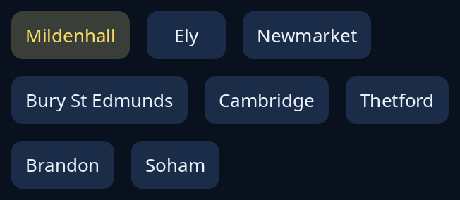

# Flow

`flow` lays items out at their own size, left to right, and goes on to the next line when a line is full, as words wrap. Use it for tags, chips and small cards, where a grid's equal tiles would be wrong. Items keep the order given, and the style sheet's gap lies between them both ways.



For the other containers, see [layout](../guides/layout.md).

<!-- picture width 360 -->
```rust
use trindle_toolkit::widget::{column, flow, word_button, Node};

fn view() -> Node<()> {
    let towns = ["Mildenhall", "Ely", "Newmarket", "Bury St Edmunds", "Cambridge", "Thetford", "Brandon", "Soham"];
    column(vec![
        flow(towns.iter().enumerate().map(|(i, town)| word_button(*town).on(i == 0).on_press(())).collect()),
    ]).padding(24.0)
}
# let _ = view();
```
