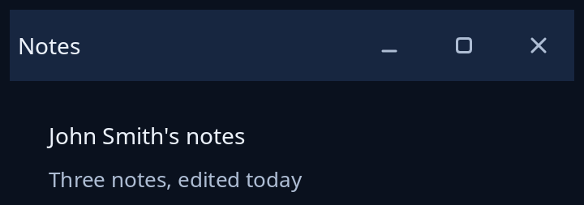

# Framed window

`framed` puts a title bar round your page for a window the compositor does not frame (`Window::needs_frame` says so). It has the title, buttons to minimise, maximise (or restore) and close, strips round the edges to resize by, and the sheet's shadow round it all. The frame only says what the person did, as a `Framing`; you hand `Move` and `Resize` to `Window::begin_move` and `begin_resize` at once, and do the rest in your own update. `Frame` says how the window stands (maximised, the room for the shadow, whether the compositor shows the window menu).



**Keys:** Tab reaches the three buttons, then Space or Enter presses one. Pressing the bar moves the window, a double press on it maximises or restores, and a right click opens the window menu (the toolkit's own when the compositor has none).

**The screen reader hears:** the title once, and buttons named Minimise, Maximise (Restore when maximised) and Close.

<!-- picture width 360 -->
```rust
use trindle_toolkit::frame::{framed, Frame, Framing};
use trindle_toolkit::widget::{column, label, note, Node};

#[derive(Clone)]
enum Msg {
    Frame(Framing),
}

fn view() -> Node<Msg> {
    let body = column(vec![
        label("John Smith's notes"),
        note("Three notes, edited today"),
    ]).gap(8.0).padding(24.0);
    framed("Notes", Frame::default(), body, Msg::Frame)
}
# let _ = view();
```
