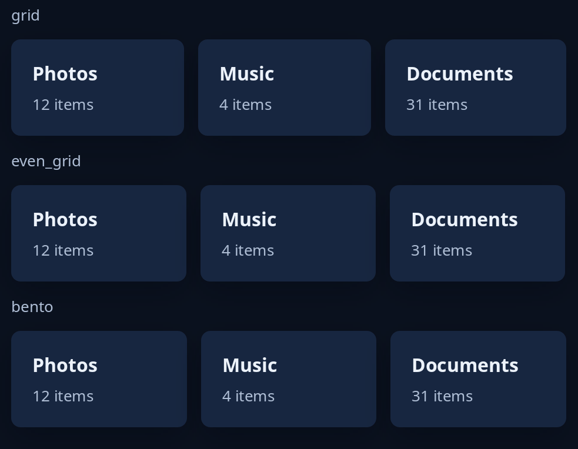

# Grids

Three ways to pack tiles into the width. `grid(min, items)` measures each tile at its own size, none narrower than `min` points, and packs them in the order given into bands that each fill the width. `even_grid(min, items)` gives every tile one width, as many to a row as fit, each row as tall as its tallest. `bento(min, gap, items)` locks the tiles marked `.beside()` into one clean rectangle; `.span(least, most, words)` says how many twelfths of the width a tile may take and the fewest points its words need.



Every grid is packed again at each width. For the other containers, see [layout](../guides/layout.md).

<!-- picture width 520 -->
```rust
use trindle_toolkit::widget::{bento, card, column, even_grid, grid, heading, note, Length, Node};

fn view() -> Node<()> {
    let tile = |name: &str, line: &str| card(column(vec![heading(name), note(line)]).gap(6.0)).width(Length::Fill);
    let cards = || vec![tile("Photos", "12 items"), tile("Music", "4 items"), tile("Documents", "31 items")];
    column(vec![
        note("grid"),
        grid(120.0, cards()),
        note("even_grid"),
        even_grid(120.0, cards()),
        note("bento"),
        bento(120.0, 12.0, cards().into_iter().map(|c| c.beside().span(4, 6, 120.0)).collect()),
    ]).gap(12.0).padding(24.0)
}
# let _ = view();
```
