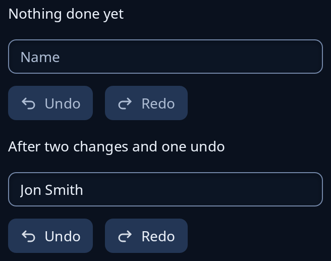

# History

`history::History` keeps the steps a program has done, each a value the program knows how to reverse, for undo and redo. It draws nothing; the program shows its state, here with Undo and Redo buttons that grey out when there is nothing to do. Typing in one box less than a second apart joins into one step with `typed`, and a new step forgets what was undone.



**Keys:** `Ui::on_undo(undo, redo)` sends your two messages for Ctrl+Z and for Ctrl+Shift+Z or Ctrl+Y, wherever the keyboard is. A text box that still has steps of its own takes the keys first, so the window carries on once the box has run out.

<!-- picture width 360 -->
```rust
use trindle_toolkit::history::History;
use trindle_toolkit::widget::{column, entry, label, quiet_action, row, Node};

#[derive(Clone)]
enum Msg {
    Name(String),
    Undo,
    Redo,
}

fn page(name: &str, steps: &History<String>) -> Node<Msg> {
    column(vec![
        entry(name, "Name", Msg::Name),
        row(vec![
            quiet_action("edit-undo-symbolic", "Undo").on_press(Msg::Undo).off(!steps.can_undo()),
            quiet_action("edit-redo-symbolic", "Redo").on_press(Msg::Redo).off(!steps.can_redo()),
        ]).gap(12.0),
    ]).gap(12.0)
}

fn view() -> Node<Msg> {
    let fresh: History<String> = History::new(50);
    let mut used: History<String> = History::new(50);
    used.push("Jon Smith".into());
    used.push("John Smith".into());
    used.undo();
    column(vec![
        label("Nothing done yet"),
        page("", &fresh),
        label("After two changes and one undo"),
        page("Jon Smith", &used),
    ]).gap(16.0).padding(24.0)
}
# let _ = view();
```
