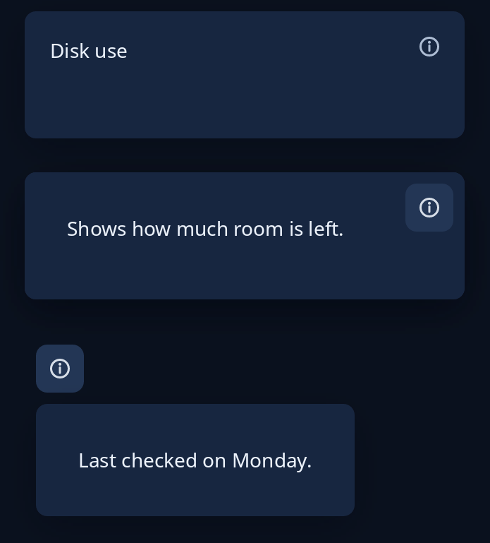

# The i panel

An "i" button gives a short help or detail without a pop-up. `hint::help_over` puts the button in the top right corner of a card and, while `open`, covers the card with the help words. For an "i" you place yourself, `popup::under_the_i` puts a panel under the button (above it where there is no room below, and kept inside the window), and `popup::dismissing` lays that panel over the page so a press anywhere else, the "i" included, sends `close`. Every "i" in every program goes through these, so each shuts the same way. The program keeps whether it is open.



**Keys:** Tab reaches the i, then Space or Enter presses it. Escape puts `help_over`'s help away.

**The screen reader hears:** with `help_over`, a button named "Show help" or, while open, "Hide help" and shown on, and the help words. The panel from `dismissing` is read as its own words.

<!-- picture width 360 -->
```rust
use trindle_toolkit::hint::help_over;
use trindle_toolkit::popup::{dismissing, under_the_i};
use trindle_toolkit::widget::{button, card, column, label, Length, Node, Rect};

#[derive(Clone)]
enum Msg {
    Toggle,
    Shut,
    Stay,
}

fn view() -> Node<Msg> {
    let shown = |open| help_over(card(label("Disk use")).width(Length::Fill).height(Length::Fill), "Shows how much room is left.", open, Msg::Toggle).height(Length::Fixed(90.0));
    let page = column(vec![
        button("dialog-information-symbolic", "Details").on(true).on_press(Msg::Shut),
        label("Mildenhall office"),
    ]).gap(12.0).padding(8.0).height(Length::Fixed(200.0));
    let panel = card(column(vec![label("Last checked on Monday.")]).padding(12.0));
    column(vec![
        shown(false),
        shown(true),
        dismissing(page, under_the_i(panel, Rect { x: 8.0, y: 8.0, w: 34.0, h: 34.0 }), Msg::Shut, Msg::Stay),
    ]).gap(24.0).padding(24.0)
}
# let _ = view();
```
