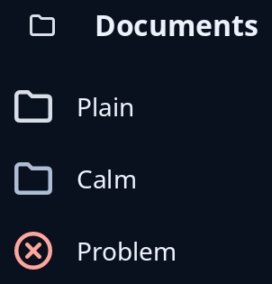

# Icons

`icon_circle` is an icon in a flat circle one step darker than the card it sits on, for beside a heading or in a list; the circle and the icon are as big as the style sheet says. `icon_image` is a plain icon at the size you give, in the ordinary text colour, or the quiet one with `Tone::Calm`, or red with `Tone::Problem` for a failure.



Neither takes a press, so there are no keys. An `icon_image` is decoration to a screen reader unless you name it with `.called(..)`.

<!-- picture width 320 -->
```rust
use trindle_toolkit::widget::{column, heading, icon_circle, icon_image, label, row, Node, Tone};

fn view() -> Node<()> {
    column(vec![
        row(vec![icon_circle("folder-symbolic"), heading("Documents")]).gap(12.0),
        row(vec![icon_image("folder-symbolic", 24.0, Tone::Plain), label("Plain")]).gap(12.0),
        row(vec![icon_image("folder-symbolic", 24.0, Tone::Calm), label("Calm")]).gap(12.0),
        row(vec![icon_image("dialog-error-symbolic", 24.0, Tone::Problem), label("Problem")]).gap(12.0),
    ]).gap(16.0).padding(24.0)
}
# let _ = view();
```
