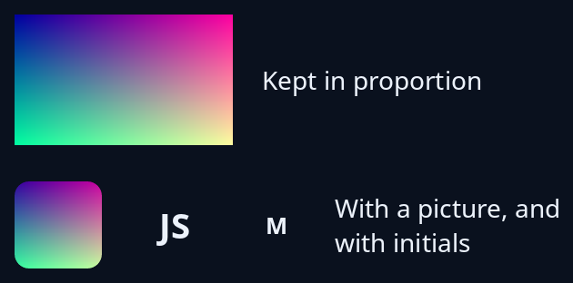

# Image and avatar

`image_view` shows a picture kept in proportion and centred, at most the size you give. `avatar` shows a soft-square picture cropped from its middle, or, with no picture, the first letters of the name. The picture is shared (`Rc`), not copied, so a list can hold many.



**The screen reader hears:** an image named by the name you give.

For rings, spinners and icons beside them, see [progress and pictures](../guides/progress.md).

<!-- picture width 360 -->
```rust
use std::rc::Rc;
use trindle_toolkit::widget::{avatar, column, image_view, label, row, Node};

fn view() -> Node<()> {
    let picture = Rc::new(image::DynamicImage::ImageRgba8(image::RgbaImage::from_fn(200, 120, |x, y| {
        image::Rgba([(x * 255 / 200) as u8, (y * 255 / 120) as u8, 160, 255])
    })));
    column(vec![
        row(vec![
            image_view(picture.clone(), "Mildenhall in the evening", (120.0, 80.0)),
            label("Kept in proportion"),
        ]).gap(16.0),
        row(vec![
            avatar(Some(picture), "Ann Lee", 48.0),
            avatar(None, "John Smith", 48.0),
            avatar(None, "Mildenhall", 32.0),
            label("With a picture, and with initials"),
        ]).gap(16.0),
    ]).gap(16.0).padding(24.0)
}
# let _ = view();
```
