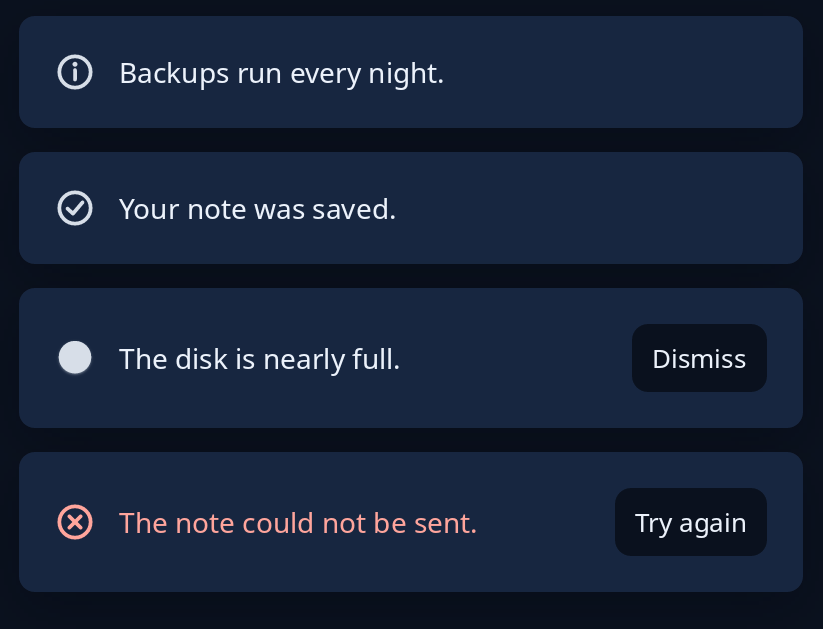

# Info panel

`info::info_panel` puts news in the page where it belongs, in place of a banner or a toast: a card with an icon, the words and any buttons at its end. There are four kinds. `Kind::Note` is news worth knowing, `Done` is something that went well, `Warning` is something to look at soon, and `Failed` is something that failed, the one kind drawn in red. It takes room in the page like any card, so put it where the page already keeps room.



**Keys:** the buttons answer to Tab, then Space or Enter. The panel itself takes no keys.

**The screen reader hears:** the words, spoken as the panel appears: a failure at once, anything else once the reader is free.

<!-- picture width 440 -->
```rust
use trindle_toolkit::info::{info_panel, Kind};
use trindle_toolkit::widget::{column, word_button, Node};

#[derive(Clone)]
enum Msg {
    Dismiss,
    Retry,
}

fn view() -> Node<Msg> {
    column(vec![
        info_panel(Kind::Note, "Backups run every night.", vec![]),
        info_panel(Kind::Done, "Your note was saved.", vec![]),
        info_panel(Kind::Warning, "The disk is nearly full.", vec![word_button("Dismiss").on_press(Msg::Dismiss)]),
        info_panel(Kind::Failed, "The note could not be sent.", vec![word_button("Try again").on_press(Msg::Retry)]),
    ]).gap(12.0).padding(24.0)
}
# let _ = view();
```
