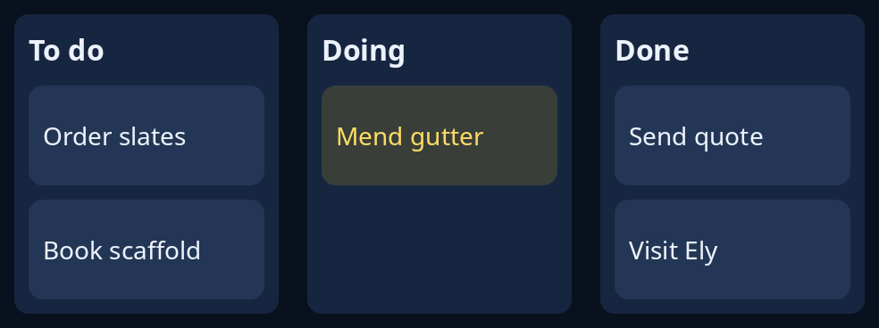

# Board of cards

`kanban::Board` is a board of cards in lanes, such as jobs to do, doing and done. The program keeps the `Board` and paints it with `paint_board` inside a `drawing`. A card is moved by dragging it, within its lane or into another (`Gesture::pointer`), or with the keys the program gives to `Board::step` and `Board::shift`.



**Keys:** none are wired for you. `Board::step(across, by, tall)` chooses the next card up or down, or the nearest in the next lane across; `Board::shift` moves the chosen card the same way and says where it went (`Touch::Moved`).

**The screen reader hears:** a table when the drawing is given `.table_rows(board.said())`: the lanes are its columns, the cards at each height are its rows, and the chosen card's row is selected.

<!-- picture width 520 -->
```rust
use trindle_toolkit::kanban::{paint_board, Board, Card, Lane};
use trindle_toolkit::widget::{column, drawing, Node};

fn lane(title: &str, cards: &[&str]) -> Lane {
    Lane {
        title: title.to_string(),
        cards: cards.iter().enumerate().map(|(id, c)| Card { title: c.to_string(), id }).collect(),
    }
}

fn view() -> Node<()> {
    let mut board = Board::new(vec![
        lane("To do", &["Order slates", "Book scaffold"]),
        lane("Doing", &["Mend gutter"]),
        lane("Done", &["Send quote", "Visit Ely"]),
    ]);
    board.lane_width = 148.0;
    board.chosen = Some((1, 0));
    let last = board.lane_rect(2, 0.0);
    let size = (last.x + last.w, board.card_rect(0, 2).y);
    let said = board.said();
    column(vec![
        drawing(size, "Jobs", move |canvas, pen| paint_board(canvas, pen, &board, None, None)).table_rows(said),
    ]).padding(16.0)
}
# let _ = view();
```
