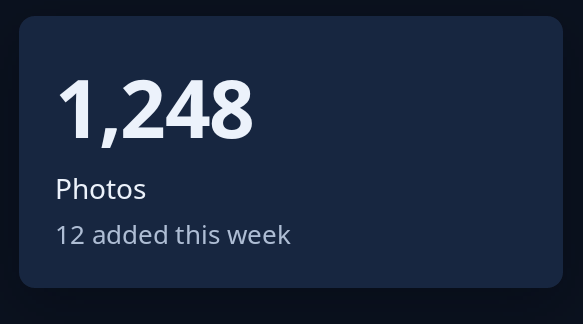

# Label, note and figure

`label` is plain words, `note` is small quiet words, and `figure` is a big figure, as on a stat tile. All three take any text. Every word shown can be selected and copied. For the other roles words can have, such as a page's name or a card's heading, see [text roles](text-roles.md).



**The screen reader hears:** the words as they are written, as a label.

<!-- picture width 320 -->
```rust
use trindle_toolkit::widget::{card, column, figure, label, note, Node};

fn view() -> Node<()> {
    column(vec![
        card(column(vec![figure("1,248"), label("Photos"), note("12 added this week")]).gap(4.0)),
    ]).padding(24.0)
}
# let _ = view();
```
