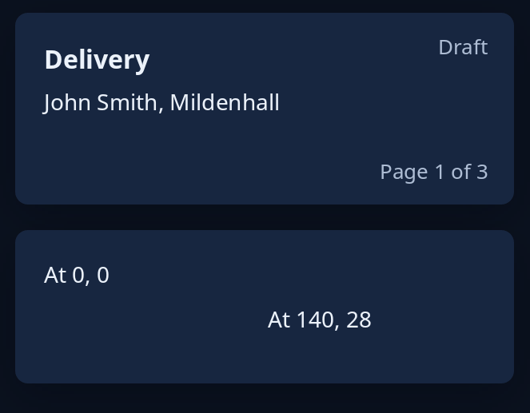

# Layers, placed and fixed

`layers` puts items over one another, each as big as the area and the last on top; only what is on top of a point is pressed there. `placed(inner, at)` gives `inner` the size it asks for and puts its top left where `at` answers: `at` is given that size and the area's, in points, and answers in points from the area's top left. `frames::fixed` puts each item at its own point whatever the room. Give the layers a height, as they take what they are given.



<!-- picture width 360 -->
```rust
use trindle_toolkit::frames::fixed;
use trindle_toolkit::widget::{card, column, heading, label, layers, note, placed, Length, Node};

fn view() -> Node<()> {
    column(vec![
        layers(vec![
            card(column(vec![heading("Delivery"), label("John Smith, Mildenhall")]).gap(6.0)),
            placed(note("Draft"), |(w, _), (area, _)| (area - w - 16.0, 12.0)),
            placed(note("Page 1 of 3"), |(w, h), (area_w, area_h)| (area_w - w - 16.0, area_h - h - 12.0)),
        ]).height(Length::Fixed(120.0)),
        card(fixed(vec![((0.0, 0.0), label("At 0, 0")), ((140.0, 28.0), label("At 140, 28"))]).height(Length::Fixed(60.0))),
    ]).gap(16.0).padding(24.0)
}
# let _ = view();
```
