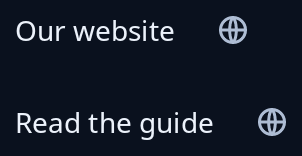

# Link

`link(address)` and `link_named(name, address)` are buttons that lead to a web address. Pointing at one shows what it is: `link` shows the host and as much of the path as fits, and `link_named` shows its name with that address on a line under it. Use `link_named` where "its website" would not say what the link is for. They are never underlined. The press is yours: give `.on_press(msg)` a message that opens this same address.



**Keys:** Tab reaches it, then Space or Enter presses it.

**The screen reader hears:** `link` as "Link to" and the shortened address, such as "Link to trindle.org". `link_named` as its name, then the same "Link to" words.

To lead to an address from inside a paragraph, see [rich text](rich-text.md). For buttons in general, see [buttons](../guides/buttons.md).

<!-- picture width 320 -->
```rust
use trindle_toolkit::widget::{column, label, link, link_named, row, Node};

#[derive(Clone)]
enum Msg {
    Open(String),
}

fn view() -> Node<Msg> {
    let site = "https://trindle.org";
    let guide = "https://trindle.org/guide";
    column(vec![
        row(vec![label("Our website"), link(site).on_press(Msg::Open(site.into()))]).gap(12.0),
        row(vec![label("Read the guide"), link_named("Trindle guide", guide).on_press(Msg::Open(guide.into()))]).gap(12.0),
    ]).gap(12.0).padding(24.0)
}
# let _ = view();
```
