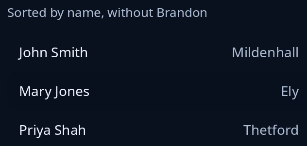

# List model

`model::ListModel` keeps the program's own things and says which of them show, in what order and in which groups. It paints nothing; it feeds a [list](list.md) (or a table) its rows. `sort_by` sets the order (ties keep the order added), `filter` keeps only what you say yes to, and `group_by` puts things with one group name together. `groups()` gives each group's name and rows, ready for a table's `set_groups`.



`push`, `remove` and `edit` place the change among the shown rows and record it. `take_changes()` hands back those changes (`Reset`, `Inserted`, `Removed`, `Changed`) so a view can follow without being rebuilt.

It has no keys and tells the screen reader nothing itself; the list or table that shows its rows does.

<!-- picture width 360 -->
```rust
use trindle_toolkit::model::ListModel;
use trindle_toolkit::widget::{column, item, list, note, Length, Node};

fn view() -> Node<()> {
    let mut people = ListModel::new(vec![
        ("Priya Shah", "Thetford"),
        ("John Smith", "Mildenhall"),
        ("Ali Khan", "Brandon"),
        ("Mary Jones", "Ely"),
    ]);
    people.sort_by(|a, b| a.0.cmp(b.0));
    people.filter(Some(Box::new(|p: &(&str, &str)| p.1 != "Brandon")));
    let rows = people.rows().map(|(name, town)| item(*name).detail(*town)).collect();
    column(vec![
        note("Sorted by name, without Brandon"),
        list(rows, None, |_| ()).called("People").height(Length::Fixed(128.0)),
    ]).gap(12.0).padding(24.0)
}
# let _ = view();
```
