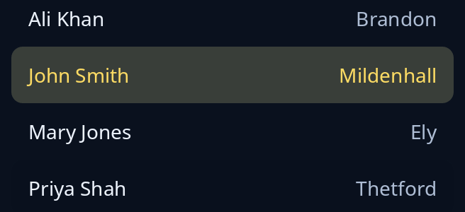

# List

`list` shows rows to choose one of. Make each row with `item(text)` and add `.icon(name)`, `.detail(text)` (words at the row's far end) or `.folder()`. Only the rows in sight are painted, so a long list costs no more than a short one. Name the list with `.called(..)`. `.on_reorder(f)` lets rows be dragged into a new order; `f` is given the row and the gap it was let go at.



**Keys:** Up, Down, Page Up, Page Down, Home and End choose a row; Enter opens it when the list has `.on_open(..)`.

**The screen reader hears:** a list box with the name you gave it. Each row is an option with its words, its detail as a description, its place in the set and whether it is chosen. An unnamed list is heard as just "list".

For scrolling and many rows, see [lists](../guides/lists.md).

<!-- picture width 360 -->
```rust
use trindle_toolkit::widget::{column, item, list, Length, Node};

#[derive(Clone)]
enum Msg {
    Chosen(usize),
    Moved(usize, usize),
}

fn view() -> Node<Msg> {
    let rows = vec![
        item("Ali Khan").detail("Brandon"),
        item("John Smith").detail("Mildenhall"),
        item("Mary Jones").detail("Ely"),
        item("Priya Shah").detail("Thetford"),
    ];
    column(vec![
        list(rows, Some(1), Msg::Chosen).called("People").on_reorder(Msg::Moved).height(Length::Fixed(168.0)),
    ]).padding(24.0)
}
# let _ = view();
```
