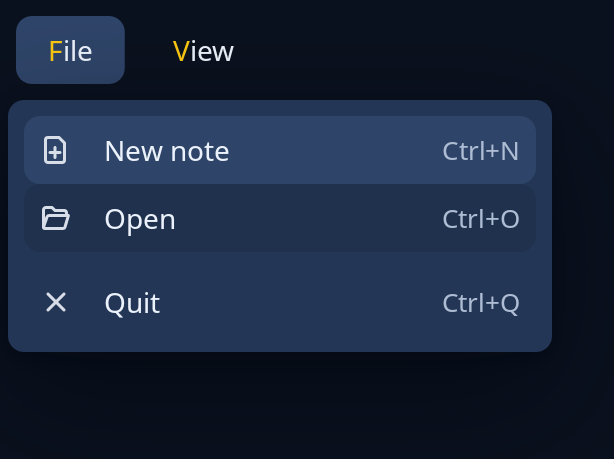

# Menu bar

`menubar::MenuBar` is a row of menu titles across the top of a window, each opening its menu below it. It floats over the page and moves nothing. The program keeps the bar, hands each `BarMsg` to `update`, and learns from `BarDone` which row of which menu was chosen. Menu rows are the same `popup::row` rows a popup menu uses: icons, keys, ticks, dots, rules and one-deep sub-menus.



**Keys:** F10 anywhere in the window opens the first menu; `MenuBar::f10` does it. Alt with the letter after an `&` in a title (or the title's first letter) opens that menu. On the bar, Left and Right move along the titles, and Up, Down, Enter or Space open the lit one. In an open menu, Up and Down move, Right and Left go to the next menu along (or open and shut a sub-menu on a row that has one), Enter or Space chooses, Escape shuts it, and a letter or figure lights the next row that starts with it.

**The screen reader hears:** a menu bar named "Menu bar" holding one menu item per title with its place in the set, the lit one selected and expanded while its menu is open; the menu as "Menu" with each row's words, then its keys, or "sub-menu" and the number of lines.

<!-- picture width 360 -->
```rust
use trindle_toolkit::menubar::{BarMsg, MenuBar};
use trindle_toolkit::popup::row;
use trindle_toolkit::widget::{column, label, Length, Node};

#[derive(Clone)]
enum Msg {
    Bar(BarMsg),
}

fn view() -> Node<Msg> {
    let mut bar = MenuBar::new(vec![
        ("&File".into(), vec![
            row("document-new-symbolic", "New note").keys("Ctrl+N"),
            row("document-open-symbolic", "Open").keys("Ctrl+O"),
            row("window-close-symbolic", "Quit").keys("Ctrl+Q").rule(),
        ]),
        ("&View".into(), vec![row("", "Wrap lines").check(true)]),
    ]);
    bar.f10();
    bar.window(column(vec![label("Welcome to Notes")]).padding(24.0).height(Length::Fixed(220.0)), Msg::Bar)
}
# let _ = view();
```
