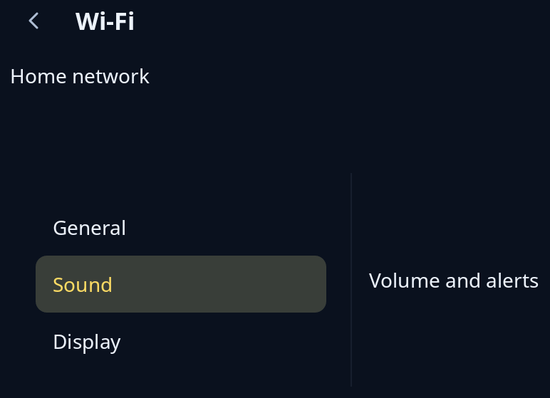

# Navigation view and split view

`nav::nav_view` puts a page under a bar with its name and, when there is a page to go back to, a Back button. `nav::split_view` puts a side bar beside its content, and on a narrow window shows one of the two at a time. The program keeps which page is shown, for example in a `nav::History`, and passes its window width from `App::resized`.



**Keys:** Tab reaches the Back button, and Enter or Space presses it. Escape sends the same message while nothing inside uses Escape. A program can also take Alt+Left, the keyboard's Back key and the mouse's back button with `nav::back_key` in its `intercept`.

**The screen reader hears:** a button named "Back"; on a narrow window only the side that is shown is heard.

The side bar is wide when the window is at least `--trindle-split-narrow` across (`nav::is_narrow`).

<!-- picture width 520 -->
```rust
use trindle_toolkit::nav;
use trindle_toolkit::widget::{column, item, label, list, Length, Node};

#[derive(Clone)]
enum Msg {
    Back,
    Place(usize),
}

fn view() -> Node<Msg> {
    let side = list(vec![item("General"), item("Sound"), item("Display")], Some(1), Msg::Place).called("Settings");
    column(vec![
        nav::nav_view("Wi-Fi", Some(Msg::Back), label("Home network")).height(Length::Fixed(100.0)),
        nav::split_view(800.0, side, label("Volume and alerts"), "Sound", false, Msg::Back).height(Length::Fixed(150.0)),
    ]).gap(24.0).padding(24.0)
}
# let _ = view();
```
