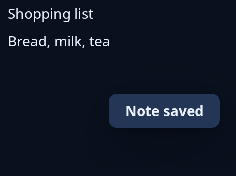

# Notices

`notices::Notices` queues short messages and shows one at a time as a pill over the foot of the window. It never moves the page, and the pointer passes through the pill's clear band. A notice stays for `--trindle-notice-stays` (5 seconds), then the next waiting one takes its place. The same words as the last one given are not queued again.

The program keeps the `Notices`, calls `push(words, now)` when something happens, `tick(now)` when its timer fires (it returns true when the window should be built again), and puts `over(page)` round the page it shows. `next_wake` says how long until `tick` has something to do, and `dismiss` takes the notice away now.



**Keys:** none; the notice takes no keys and no press.

**The screen reader hears:** the notice's words, politely, once the reader is free, as they come.

For news that stays in the page, see [info panel](info-panel.md).

<!-- picture width 360 -->
```rust
use std::time::Instant;

use trindle_toolkit::notices::Notices;
use trindle_toolkit::widget::{column, label, Length, Node};

fn view() -> Node<()> {
    let mut notices = Notices::new();
    notices.push("Note saved", Instant::now());
    let page = column(vec![label("Shopping list"), label("Bread, milk, tea")]).gap(8.0).padding(24.0).height(Length::Fixed(180.0));
    notices.over(page)
}
# let _ = view();
```
