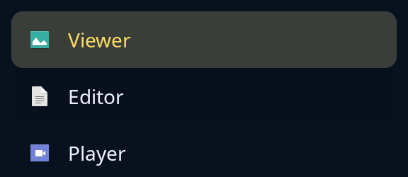

# Open with

`open_with::chooser` is the list of apps to pick from, by icon and name. `open_with::apps(&Places::of_this_desktop())` reads the installed apps from the desktop's own files; `App::command(&files)` gives the command that opens files in one, each file kept as one word so no name is read by a shell. `set_default` makes an app the person's default for a kind of file.



**Keys:** it is a list, so Up, Down, Page Up, Page Down, Home and End choose a row.

**The screen reader hears:** a list box called "Apps", each app an option named by its name, the chosen one selected.

See [list](list.md) for the rows.

<!-- picture width 320 -->
```rust
use trindle_toolkit::open_with::{chooser, App};
use trindle_toolkit::widget::{column, Length, Node};

fn app(name: &str, icon: &str) -> App {
    App {
        id: format!("org.example.{name}.desktop"),
        name: name.to_string(),
        icon: icon.to_string(),
        exec: format!("{} %f", name.to_lowercase()),
        mimes: Vec::new(),
    }
}

fn view() -> Node<()> {
    let apps = [app("Viewer", "image-x-generic"), app("Editor", "text-x-generic"), app("Player", "video-x-generic")];
    column(vec![
        chooser(&apps, Some(0), |_| ()).height(Length::Fixed(128.0)),
    ]).padding(24.0)
}
# let _ = view();
```
