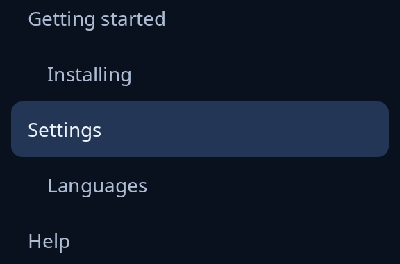

# Outline

`outline::outline` lists the places to go on a long page, with where you are marked, for a side panel. Each `Entry::new(title, depth, key)` names a heading, how deep it sits (0 for a part of the page, 1 for a part of a part) and the key of the widget it points at. A deeper heading is set in by a step per level.



Ask `Ui::reading(&keys)` which heading is being read and pass it as `current`. When a row is chosen, answer with `Shown::go_to(&entries[i].key)` to scroll the page there.

**Keys:** it is a list, so Up, Down, Page Up, Page Down, Home and End choose a row.

**The screen reader hears:** a list box called "Places", each heading an option, the one being read selected. The indent is spaces the reader passes over.

<!-- picture width 320 -->
```rust
use trindle_toolkit::outline::{outline, Entry};
use trindle_toolkit::widget::{column, Length, Node};

fn view() -> Node<()> {
    let entries = [
        Entry::new("Getting started", 0, "start"),
        Entry::new("Installing", 1, "install"),
        Entry::new("Settings", 0, "settings"),
        Entry::new("Languages", 1, "languages"),
        Entry::new("Help", 0, "help"),
    ];
    column(vec![
        outline("places", &entries, Some(2), |_| ()).height(Length::Fixed(208.0)),
    ]).padding(24.0)
}
# let _ = view();
```
