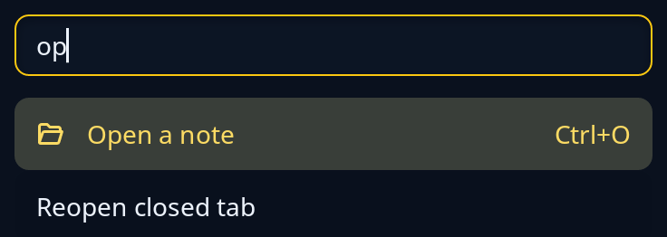

# Command palette

`palette::Palette` is a page with a box to type in and the actions that match, any of which runs with Enter or a click. It searches the program's `action::Actions`, the same list a menu or a toolbar shows, so the words, icon and shortcut are kept once. Matching actions list with their shortcuts at the end of the row; when none matches, words say so. Nothing floats: give it the page.

The program keeps the `Palette`, passes each `Edit` to `update` with its actions, and gets back the id of the action to run when one is run. Running an action empties the palette.



**Keys:** the box has the keyboard first. Typing narrows the list, Enter runs the chosen row, and in the list Up and Down choose a row, and Enter or a double click runs it.

**The screen reader hears:** the box as a text input named "Type to find an action", the matches as a list, and "No action matches." when there are none.

<!-- picture width 400 -->
```rust
use trindle_toolkit::action::{Action, Actions};
use trindle_toolkit::palette::{Edit, Palette};
use trindle_toolkit::widget::{column, Node};

#[derive(Clone)]
enum Msg {
    Find(Edit),
}

fn view() -> Node<Msg> {
    let mut actions = Actions::new();
    let _ = actions.add(Action::new("save", "Save").icon("document-save-symbolic").keys("Ctrl+S"));
    let _ = actions.add(Action::new("open", "Open a note").icon("document-open-symbolic").keys("Ctrl+O"));
    let _ = actions.add(Action::new("reopen", "Reopen closed tab"));
    let palette = Palette { query: "op".into(), chosen: 0 };
    column(vec![palette.view(&actions, Msg::Find)]).padding(24.0)
}
# let _ = view();
```
