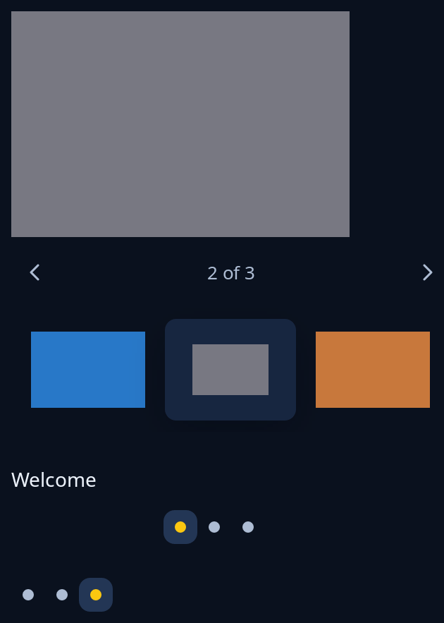

# Photo gallery, pager and dots

`photos::gallery` shows one large picture with arrow buttons and a count, over a strip of thumbnails that scrolls sideways when they do not fit. `frames::pager` lays pages side by side, slid to show one, over their dots. `frames::dots` is the row of dots alone, a dot for each page with the current one in the highlight. The program keeps which one is shown and moves it from the message each sends.



**Keys:** in the gallery, Tab reaches the large picture; then Left, Up and Page Up show the one before, Right, Down and Page Down the one after, Home the first and End the last. In the pager and dots, Tab reaches each dot and Space or Enter shows its page.

**The screen reader hears:** in the gallery, the large picture and each thumbnail named "Photo 2, 2 of 3" with the shown thumbnail marked, and "2 of 3" as the count; each dot is named "Page 2 of 3" and the current one is marked on.

<!-- picture width 360 -->
```rust
use std::rc::Rc;
use trindle_toolkit::frames::{dots, pager};
use trindle_toolkit::photos::gallery;
use trindle_toolkit::widget::{column, label, Node};

#[derive(Clone)]
enum Msg {
    Show(usize),
    Page(usize),
}

fn view() -> Node<Msg> {
    let slides: Vec<_> = (0..3u8)
        .map(|i| {
            let picture = image::RgbaImage::from_pixel(60, 40, image::Rgba([40 + i * 80, 120, 200 - i * 70, 255]));
            (Rc::new(image::DynamicImage::ImageRgba8(picture)), format!("Photo {}", i + 1))
        })
        .collect();
    let pages = vec![label("Welcome"), label("Your notes"), label("All set")];
    column(vec![
        gallery("trip", &slides, 1, (240.0, 160.0), Msg::Show),
        pager(pages, 240.0, 0.0, Msg::Page),
        dots(3, 2, Msg::Page),
    ]).gap(24.0).padding(24.0)
}
# let _ = view();
```
