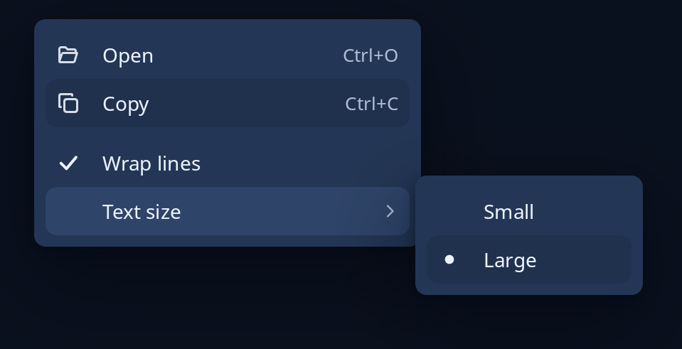

# Popup menu

`popup::Popup` is a menu that floats over the page and moves nothing. The program keeps it, hands each `PopupMsg` to `update`, and learns from `Done` whether it is still open, which row was chosen (`Picked`), or which row of a sub-menu (`PickedIn`). `Popup::over(page, wrap)` lays it over the page; a press anywhere else closes it. A row, made with `popup::row(icon, words)`, can carry keys shown faintly at the end, a rule above it, a tick (`check`), a dot (`radio`) or a one-deep sub-menu.

For the menu a right click on a drawing opens, `Node::menu` takes a function from where it fell to `MenuRow`s, which send your message or copy words.



**Keys:** Up and Down move the lit row, Right opens the lit row's sub-menu and Left shuts it, Enter or Space chooses, Escape shuts the sub-menu and then the menu, and the Menu key closes. A letter or figure lights the next row that starts with it. `popup::key` and `popup::typed` turn keys into messages.

**The screen reader hears:** a menu named "Menu" with each row's words, then its keys, or "sub-menu" and how many lines it holds.

<!-- picture width 520 -->
```rust
use trindle_toolkit::popup::{row, Place, Popup, PopupMsg};
use trindle_toolkit::widget::{column, label, Length, Node};

#[derive(Clone)]
enum Msg {
    Menu(PopupMsg),
}

fn view() -> Node<Msg> {
    let mut menu = Popup::new(vec![
        row("document-open-symbolic", "Open").keys("Ctrl+O"),
        row("edit-copy-symbolic", "Copy").keys("Ctrl+C"),
        row("", "Wrap lines").check(true).rule(),
        row("", "Text size").sub(vec![row("", "Small").radio(false), row("", "Large").radio(true)], 160.0),
    ], Place::At(24.0, 24.0));
    menu.update(PopupMsg::Pick(3));
    menu.over(column(vec![label("Notes")]).padding(24.0).height(Length::Fixed(240.0)), Msg::Menu)
}
# let _ = view();
```
