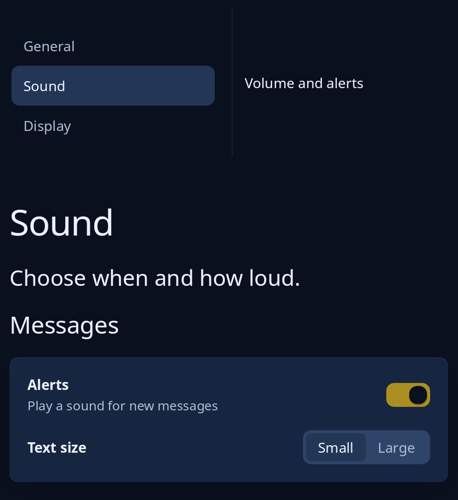

# Preferences and settings pages

`settings::setting` is one row of a settings page: the setting's name over a line of help on the left, and its control at the end of the row. `settings::setting_page` stacks the rows into groups, each a section name over a card, under a title and a sentence, and scrolls. `pages::preferences` puts the names of such pages in a side bar beside the one shown, and on a narrow window shows the list alone until a page is chosen, then that page with a Back button.



**Keys:** in the list of pages, Up, Down, Page Up, Page Down, Home and End move the chosen page. A setting row has no keys of its own; its control answers to its own.

**The screen reader hears:** the list as "Pages" with the chosen page selected; on a narrow window the page shown is named after it and has a Back button. A row's name and help are read as words, and its control tells its own role and name.

Pass the window's width from `App::resized` to `preferences`; below `--trindle-split-narrow` only one side shows. For the look settings a program keeps, see [crash, look and shortcuts](crash-look-shortcuts.md).

<!-- picture width 520 -->
```rust
use trindle_toolkit::pages::preferences;
use trindle_toolkit::settings::{setting, setting_page};
use trindle_toolkit::widget::{column, item, label, one_of, switch, Length, Node};

#[derive(Clone)]
enum Msg {
    Back,
    Page(usize),
    Alerts(bool),
    Size(usize),
}

fn view() -> Node<Msg> {
    let pages = vec![item("General"), item("Sound"), item("Display")];
    let rows = vec![
        setting("Alerts", "Play a sound for new messages", switch(true, "Alerts", Msg::Alerts)),
        setting("Text size", "", one_of(vec!["Small".into(), "Large".into()], Some(0), "Text size", Msg::Size)),
    ];
    column(vec![
        preferences(800.0, pages, 1, Msg::Page, false, Msg::Back, label("Volume and alerts")).height(Length::Fixed(150.0)),
        setting_page("sound", "Sound", "Choose when and how loud.", vec![("Messages".to_string(), rows)]).height(Length::Fixed(360.0)),
    ]).gap(24.0).padding(24.0)
}
# let _ = view();
```
