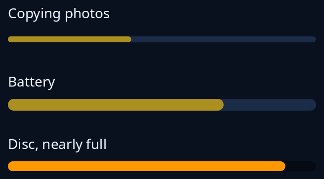

# Progress bars

Three bars for how far or how full. `bars::progress_bar(share, name)` shows a job: `share` is 0 to 1, or `None` while the end cannot be guessed, when a short piece crosses it again and again (it rests at the start when the person wants less motion). `dial::level_bar(value, min, max, name)` shows how full something is, such as a battery. `tiles::fill_bar(share, name)` is a thin fullness bar for a card; it turns to the warning colour from 85 per cent and to the problem colour from 95 per cent, and with no share it is the empty track.



**The screen reader hears:** a progress indicator called by the name you give, with its share from 0 to 1. `progress_bar` with no share is heard as busy.

Put the name in words beside the bar as well. See [progress](../guides/progress.md).

<!-- picture width 360 -->
```rust
use trindle_toolkit::bars::progress_bar;
use trindle_toolkit::dial::level_bar;
use trindle_toolkit::tiles::fill_bar;
use trindle_toolkit::widget::{column, label, Node};

fn view() -> Node<()> {
    column(vec![
        column(vec![label("Copying photos"), progress_bar(Some(0.4), "Copying photos")]).gap(8.0),
        column(vec![label("Battery"), level_bar(7.0, 0.0, 10.0, "Battery")]).gap(8.0),
        column(vec![label("Disc, nearly full"), fill_bar(Some(0.9), "Disc")]).gap(8.0),
    ]).gap(24.0).padding(24.0)
}
# let _ = view();
```
