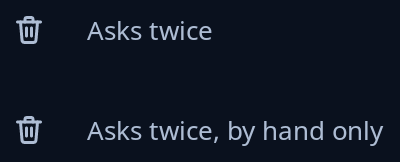

# Remove buttons

`remove` is the one button for taking something away that cannot be got back. It asks twice: the first press arms it, filled in the highlight with its label asking "Click again to ...", and only a second press within three seconds sends your message. Left alone, it stands down. `remove_by_hand` is the same, but the first press must also be the person's own.



**Keys:** Tab reaches it, then Space or Enter presses it, the first time to arm it and the second to act.

**The screen reader hears:** a button named by the tip. After the first press it is told "Click again to" and the tip.

For `remove_by_hand` the third argument names an act that your program's `Host::act` lists as the person's own; a press that is not theirs arms nothing. The other buttons are in [buttons](../guides/buttons.md).

<!-- picture width 400 -->
```rust
use trindle_toolkit::widget::{column, note, remove, remove_by_hand, row, Node};

#[derive(Clone)]
enum Msg {
    Delete,
    Forget,
}

fn view() -> Node<Msg> {
    column(vec![
        row(vec![
            remove("user-trash-symbolic", "Delete the report").on_press(Msg::Delete),
            note("Asks twice"),
        ]).gap(12.0),
        row(vec![
            remove_by_hand("user-trash-symbolic", "Forget this network", "forget-network").on_press(Msg::Forget),
            note("Asks twice, by hand only"),
        ]).gap(12.0),
    ]).gap(16.0).padding(24.0)
}
# let _ = view();
```
