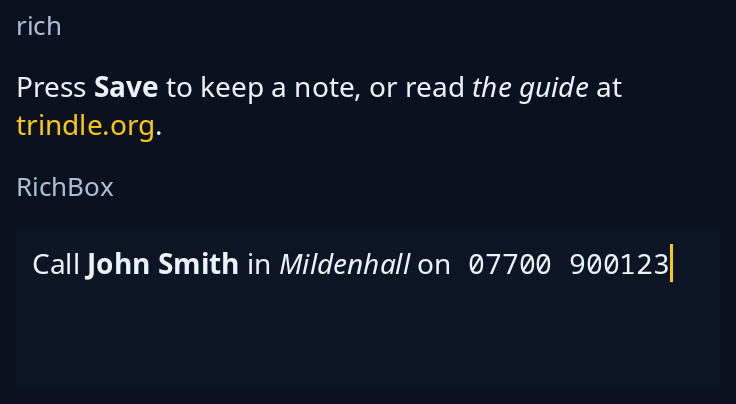

# Rich text

`rich(spans)` is one paragraph of words in several looks, bold, italic, code and links, wrapped as one. Build the spans with `rich::Span`, or read them from a small markup with `rich::parse` (`**bold**`, `*italic*`, `` `code` ``, `[words](address)`). Links are in the highlight's colour, never underlined, and `.on_link(f)` hears the address of the one pressed. `editing::rich_box::RichBox` is a box to type such words in; keep it in the program's state, hand each `Event` it sends back to `apply`, and save `markup()`.



**Keys:** in `rich`, Tab goes from link to link inside the paragraph and Enter follows the one marked. In `RichBox`, Ctrl+B, Ctrl+I and Ctrl+E turn bold, italic and code on or off for what is selected, or for what is typed next; Ctrl+Z undoes, Ctrl+Y or Ctrl+Shift+Z redoes, and Ctrl+A selects all.

**The screen reader hears:** `rich` as a paragraph with its words, and each link as a link with its address, which it can follow. `RichBox` as a multi-line text box with the name you give it, its lines, the caret and the selection.

<!-- picture width 400 -->
```rust
use trindle_toolkit::editing::rich_box::{Event, RichBox};
use trindle_toolkit::rich::parse;
use trindle_toolkit::widget::{column, note, rich, Length, Node};

#[derive(Clone)]
enum Msg {
    Open(String),
    Typed(Event),
}

fn view() -> Node<Msg> {
    let typed = RichBox::new("Call **John Smith** in *Mildenhall* on `07700 900123`");
    column(vec.")).on_link(Msg::Open),
        note("RichBox"),
        typed.node("Note", 80.0, Msg::Typed).height(Length::Fixed(80.0)),
    ]).gap(12.0).padding(24.0)
}
# let _ = view();
```
